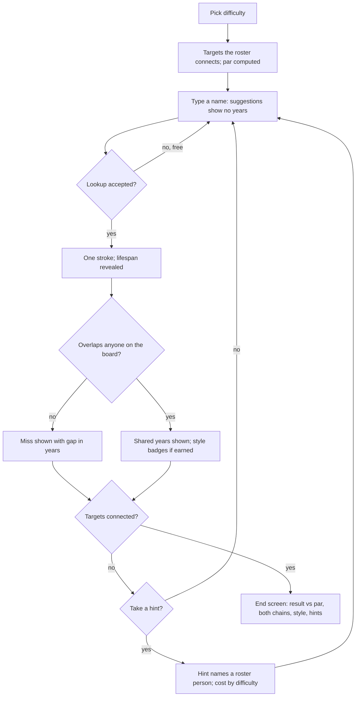
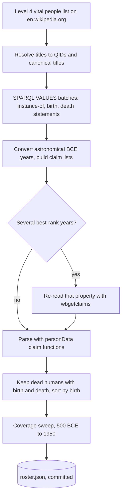
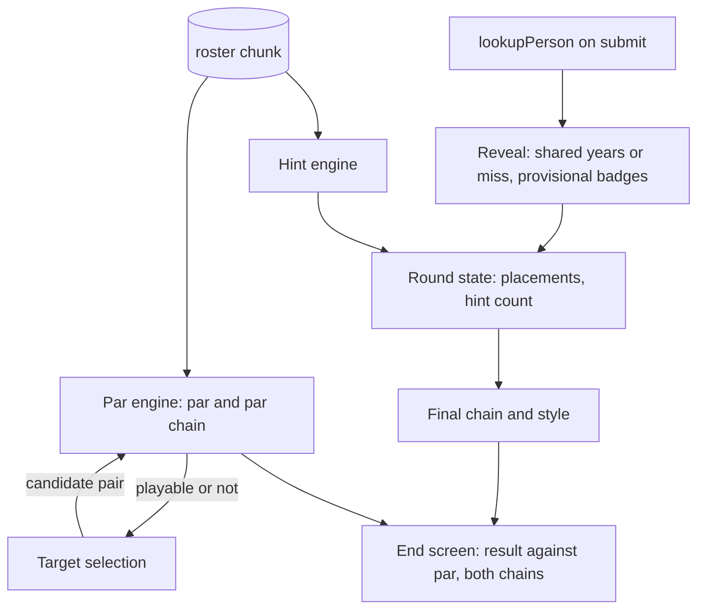

# Core Loop v2 Round - Plan

## Goal Capsule

- **Objective:** A streamer can win a round with a pick their chat did not see coming, and anyone watching can tell from the screen how good that pick was.
- **Means:** A committed roster of Wikipedia's Level 4 vital people drives par and hints, pure engines compute the reveal and style, and the round and end screens show them (KTD1, KTD6, KTD8).
- **Product authority:** This plan defines one round: strokes, par, hidden dates, the overlap reveal, style, hints and the end screen (issue #54, round scope). The daily puzzle (#58), share card and challenge links (#59), suggestion picks (#60) and versus (#61) build on the round and are not active scope.
- **Execution profile:** Deep. One pull request (KTD13), units U1–U9 in dependency order. U2's roster builder needs network access to en.wikipedia.org, query.wikidata.org and www.wikidata.org once; everything else runs offline.
- **Stop conditions:** Stop and report if the builder cannot reach Wikimedia, or if the roster still has a coverage gap between 500 BCE and 1950 after the Level 5 fill (Assumptions).
- **Who finishes:** `ce-work` implements and verifies; the pull request opens when the user asks for it.
- **Open blockers:** None.

---

## Product Contract

### Summary

Each round becomes golf against par, where par is the shortest chain the game can build from its own roster of well-known people.
Lifespans stay hidden until a person is placed; placing them reveals the years they shared with everyone they overlap, or how far they missed.
Clutch overlaps and long bridges earn style badges that only break ties, hints cost more as difficulty rises, and the end screen sets the player's chain beside the par chain.

### Problem Frame

The game has no benchmark. The score is the count of people added (`src/app/page.tsx:123`), judged against fixed bands where 3 or fewer is "Expert historian" (`src/lib/components/ui/WinModal.tsx:39`). Two intermediates between Cleopatra and Einstein earn the same message as two between Lincoln and Darwin, so neither the player nor chat can tell whether a round was good.

The answer leaks before the player commits. Autocomplete shows each person's Wikipedia short description (`src/lib/components/ui/SearchBar.tsx:111`), and those descriptions often carry the dates: "Roman general and dictator (100–44 BC)", "Pharaoh of Egypt from 51 to 30 BC". The round turns into planning a route from visible data instead of remembering when people lived.

Nothing marks the moment a pick lands. A placed person is sorted into the timeline and coloured; the overlap that made the pick work is never stated. That overlap is the product's whole position (STRATEGY.md: "score the overlap itself"). The streamer research found that clip-worthy moments in GeoGuessr-style games come from a reveal after commitment, measured against a benchmark the audience already understands.

The flex this game should reward is specialist knowledge: someone who lived a hundred years around 1500, a figure from the thin centuries between 600 and 1000 CE, two lives that overlapped by months. The current round gives that knowledge no stage.

---

<!-- ce-section: work-relationships -->
### How This Work Fits Together

This plan covers the round. The breakdown below is the current understanding, not a committed roadmap.

- Existing issues this round absorbs as implementation pieces:
  - #57 par and best chain: implements R2–R6 and the par chain in R21.
  - #56 overlap reveal: implements R9–R11.
  - #51 contemporary hints: superseded by R18–R19; hints come from the roster instead of search results.
  - #64 one score scale: resolved by R6 and R23.
- #55 lifespan bars and the gap left to bridge: can proceed independently of this plan.
- #63 zoom and #66 mobile and stream layout: can proceed independently of this plan.
- #65 on-screen rules: shares this plan's rules; its copy must describe strokes, par, hidden dates and hint costs.
- Later modes:
  - #58 daily puzzle: depends on par (R2) as the shared benchmark.
  - #59 share card: depends on the result line and end screen (R6, R21).
  - #60 suggestion picks: depends on hidden dates (R7); picks must be dateless too.
  - #61 versus: depends on the style tiebreaker (R17).
- #43 PostHog: enables the "completed sessions" metric; a completed round is one that reaches R20's end condition.
- #52 target selection: decided in `docs/research/2026-11-06-difficulty-balancing.md`; difficulty moves from birth-year gap to par and options per step.

---

### Key Decisions

- **Golf against par, with style kept separate.** (session-settled: user-directed — chosen over a points total where high score wins, and over golf with no bonuses: keeps the puzzle pure while still giving niche picks visible credit.) Governs R2, R6, R17.
- **Every placed person is a stroke; rejected entries are free.** (session-settled: user-approved — chosen over counting only the final chain with three strikes, and over counting only the final chain with free misses: wrong-era guesses must cost something or spamming names wins.) Governs R1.
- **Lifespans hidden until placed.** (session-settled: user-approved — chosen over showing dates in autocomplete and over letting a hint reveal dates: knowing when people lived is the skill being shown off.) Governs R7, R8.
- **All four style flexes belong to the round's design: deep cut, clutch overlap, real connection, long bridge.** (session-settled: user-directed — chosen over a subset: each rewards a different kind of history knowledge.) Governs R12, R13.
- **Style only breaks ties.** (session-settled: user-approved — chosen over a separate style leaderboard and over display-only badges: style never beats a lower stroke count.) Governs R17.
- **Approximate dates keep links valid but earn no date-based style.** (session-settled: user-approved — chosen over treating "c." dates as exact, and over widening them into ranges: a clutch overlap built on rough dating is an artefact.) Governs R16.
- **No stroke cap and no clock.** (session-settled: user-directed — chosen over ending the round at par + 4 and over a time limit: a bad round is a high score, not a bust, and thinking aloud is the content.) Governs R20.
- **Hint cost scales with difficulty.** (session-settled: user-directed — chosen over a flat one-stroke hint, over free / +1 / no hints, and over free / free / +1: help should cost more as the player claims more skill.) Governs R19.
- **The first slice ships clutch overlap and long bridge; deep cut and real connection follow.** The two shipped flexes need only dates the game already has; the deferred two need new per-person data from a rate-limited API. Governs R12, R13.
- **Par counts only well-known people.** Knowing someone outside the roster is the way to beat par, which rewards obscure knowledge before the deep cut badge exists. Governs R2, R4.
- **One roster feeds par, hints and the par chain.** A hint then always names someone par could have used, and the end screen compares against the same source. Governs R2, R18, R21.
- **Misses are revealed, not just counted.** "Missed by 18 years" is a stream moment and costs nothing beyond date arithmetic. Governs R10.
- **Difficulty is set by par and the options at the narrowest step, not by years apart.** Bands and evidence are in `docs/research/2026-11-06-difficulty-balancing.md` (built in #52); hint cost also scales with difficulty. Governs R5, R19.

---

### Requirements

**Strokes and par**

- R1. Every person placed on the timeline is one stroke, whether or not they end up on the final chain; entries the game rejects (not found, not a person, no dates, duplicates, lookup failures) cost nothing.
- R2. Each round has a par: the fewest roster people (R4) needed to connect the two targets.
- R3. Par and the running stroke count stay visible for the whole round.
- R4. The roster holds only well-known people with reliable dates from Wikimedia, so knowing someone less famous is how a player beats par.
- R5. A target pair is offered only when the roster connects it and the two targets' lives do not already overlap, so par is always at least 1.
- R6. The result reads as strokes relative to par, using golf names for eagle (−2), birdie (−1), par and bogey (+1), and the signed difference otherwise.

**Hidden dates**

- R7. Until a person is placed, no year tied to them appears anywhere the player looks while choosing, including in autocomplete descriptions.
- R8. The two targets' lifespans are visible from the start of the round.

**The reveal**

- R9. Placing a person reveals their lifespan and how many years they shared with each overlapping person already on the board, with the overlaps that extend or complete the chain called out first.
- R10. A placement that overlaps nobody is revealed as a miss, showing the gap in years to the nearest life on the board.
- R11. Two lives that share only part of one calendar year count as overlapping and are shown as overlapping by less than a year.

**Style**

- R12. Clutch overlap: a link on the final chain whose two lives share 5 years or fewer.
- R13. Long bridge: a person on the final chain who lived 90 years or more.
- R14. Only people and links on the final chain earn style; placements off the chain earn none.
- R15. When several shortest chains exist through the player's placements, the one earning the most style counts.
- R16. Links that use approximate ("c.") years are valid, but clutch overlap and long bridge are earned only when every year involved is exact.
- R17. Style shows as badges on the reveal and the end screen and never changes the golf result; when two results on the same puzzle are compared, fewer strokes win and style breaks ties.

**Hints**

- R18. A hint names one roster person who would extend the player's progress toward connecting the targets, without revealing that person's dates.
- R19. Hint cost follows difficulty: on Easy hints are free and unrecorded; on Medium they are free but counted on the end screen; on Hard each hint adds one stroke.

**End of round**

- R20. The round is complete when the chain connects the targets; no stroke count or clock ends it.
- R21. The end screen shows strokes, par, the result (R6), the player's chain with shared years on each link, style earned, hints used where R19 records them, and the par chain.
- R22. Beating par is celebrated more loudly than matching it, and when the player's chain differs from the par chain both are shown side by side.
- R23. The fixed score bands are removed; every score message is relative to par.

---

### Key Flows

- F1. Playing a round
  - **Trigger:** The player picks a difficulty.
  - **Steps:** The game picks targets the roster connects and computes par. The player types a name; suggestions carry no years. An accepted lookup costs a stroke and triggers the reveal: shared years with each overlapping person, or the size of the miss, plus any style earned. The player may take a hint at the difficulty's price. This repeats until the chain connects.
  - **Outcome:** The end screen shows the result against par and both chains.
  - **Covered by:** R1–R23.



---

### Acceptance Examples

- AE1. **Covers R9, R12.** Given Jane Austen (1775–1817) on the board, when the player places Charles Dickens (1812–1870), the reveal shows they shared 5 years and, if the link is on the final chain, it earns clutch overlap.
- AE2. **Covers R11, R12.** Given Michelangelo (1475–1564) on the board, when the player places Galileo Galilei (1564–1642), the link is valid, shows as overlapping by less than a year, and earns clutch overlap if it is on the final chain.
- AE3. **Covers R10, R1.** Given only Mozart (1756–1791) and the targets on the board, when the player places Abraham Lincoln (1809–1865) and Lincoln overlaps nobody, the reveal shows a miss by 18 years and the stroke still counts.
- AE4. **Covers R13, R14.** Given Bernard de Fontenelle (1657–1757) is placed, when he sits on the final chain he earns long bridge; when the final chain routes around him he earns nothing.
- AE5. **Covers R16.** Given Johannes Gutenberg with an approximate birth year, when he links to someone with 3 shared years, the link counts toward the chain but earns no clutch overlap.
- AE6. **Covers R1.** When the player enters "Rome", or a name already on the board, the entry is rejected and the stroke count does not change.
- AE7. **Covers R19, R1.** Given a Hard round, when the player takes one hint and places the hinted person, the stroke count rises by 2. On Medium the same actions add 1 stroke and the end screen records 1 hint. On Easy they add 1 stroke and no hint is recorded.
- AE8. **Covers R7.** When the player types "Cleopatra", the suggestion reads like "Pharaoh of Egypt" and shows no year, not "Pharaoh of Egypt from 51 to 30 BC".
- AE9. **Covers R6, R22.** Given par is 3, when the player connects the targets with 2 placed people, the result reads "−1, birdie" and the end screen shows the player's chain beside the par chain.
- AE10. **Covers R5.** When a candidate target pair already overlaps, or the roster cannot connect it, the pair is never offered.

---

### Success Criteria

- A viewer told nothing about the rules can say, from the reveal alone, whether a pick connected and by how many years.
- In playtests of this slice, rounds that beat par use at least one person from outside the roster, which shows par is beaten by knowledge rather than luck.
- Clutch overlap and long bridge each appear in some rounds but not in most, so the badges stay worth showing off.

---

### Scope Boundaries

**Deferred for later**

- Deep cut style, which needs a count of Wikipedia language editions for every person.
- Real connection style, which needs Wikidata relationship statements (teacher, student, spouse, rival and similar).
- A give-up button that reveals the par chain; New Game remains the exit.
- Lifespan bars across the whole timeline and a "gap left to bridge" readout (#55).
- Daily puzzle, share card, suggestion picks and versus (#58–#61); the style tiebreaker first matters in these.

**Outside this product's identity**

- A stroke cap or time limit that can end a round in failure.
- Showing lifespans before the player commits a stroke.
- Entries that are not people.

---

### Dependencies / Assumptions

- Overlap uses the existing contemporaries rule, where years are inclusive (`src/lib/utils/ChainAnalyzer.ts:16`); KTD6 sets how par is searched.
- Year 0 is not skipped yet (#53), so shared-year counts across 1 BCE to 1 CE are off by one; this is accepted until #53 lands.
- Living people count as alive through the current year, as lookups already record them.
- Wikimedia rate-limits hard, so building the roster must not cost hundreds of live requests per round.

---

### Sources / Research

- STRATEGY.md: positioning "score the overlap itself", people-only and Wikimedia-only boundaries, streamers as the main channel.
- docs/audits/2026-11-02-current-state-audit.md: as-built rules, score display and hint defects.
- docs/research/2026-11-02-streamer-guessing-games.md: reveal-after-commitment and closeness scoring in GeoGuessr-style streams.
- src/lib/services/WikipediaService.ts:154 and src/lib/components/ui/SearchBar.tsx:111: autocomplete shows Wikipedia short descriptions; src/lib/services/__fixtures__/wikimedia-responses.json shows dates inside them.
- src/lib/components/ui/DetailPanel.tsx:34: current hints come from `findContemporaries`, which returns year articles (#51).
- src/lib/services/TargetSelectionService.ts:200: current difficulty gaps.

---

## Planning Contract

**Product Contract preservation:** restructured, no scope change. The five "Deferred to Planning" questions are answered by KTD1, KTD2, KTD5, KTD6 and KTD10, or moved to Deferred to Implementation below, and the Product Contract's Outstanding Questions section is removed. The Dependencies line that said par reuses the existing shortest-path search now points to KTD6, which replaces that search. All R, F and AE IDs are unchanged.

### Key Technical Decisions

- KTD1. **The roster is Wikipedia's Level 4 vital people list, resolved to Wikidata.** "Wikipedia:Vital articles/Level 4/People" is an editor-curated list of about 2,000 people, so "well-known" has a public definition a streamer can check. A Wikidata sitelinks threshold over all humans was the alternative, and that query times out on the Wikidata Query Service (probe: 65 s upstream timeout). Governs R4.
- KTD2. **A build-time builder snapshots the roster into a committed JSON file.** It reads the list's links, resolves titles to QIDs and canonical titles, fetches instance-of, birth and death statements in SPARQL `VALUES` batches (probe: 4 items in 0.3 s), and parses them with the claim functions in `src/lib/services/personData.ts`. Roster dates then follow the same rank, precision and circa rules as `lookupPerson`. Governs R4.
- KTD3. **SPARQL BCE years are converted from astronomical to historical numbering.** Wikidata's RDF time values count 1 BC as year 0: Caesar's preferred birth is `-0099` from SPARQL but -100 from the JSON API the game reads (`src/lib/services/WikipediaService.test.ts` expects -100). The builder subtracts one from every SPARQL year of 0 or below before parsing. Governs R4.
- KTD4. **Items that are ambiguous in SPARQL are re-read from the JSON API.** SPARQL rows carry no statement order, while `rankedClaims` takes the first statement of the best rank. When an item has several best-rank birth or death values with different years, the builder re-reads that property with `wbgetclaims` so the roster matches what a lookup returns. Governs R4.
- KTD5. **The roster loads as a lazy client chunk, and par and hints make no Wikimedia requests.** About 2,000 compact rows (QID, title, birth, death, approximation flags) sorted by birth are roughly 100 KB before compression. The chunk loads once when a round starts or a saved round restores. Governs R2, R18.
- KTD6. **Par is a greedy furthest-reach sweep over the birth-sorted roster, computed in the browser per round.** From the earlier target, repeatedly take the roster person who is born no later than the current reach and dies latest; the number of steps until the reach meets the later target's birth is par, and those steps are the par chain. On interval graphs this greedy count equals the BFS shortest path, so the O(n²) adjacency build in `analyzeChain` is not reused for 2,000 nodes. Both targets' QIDs are excluded from the candidates. Governs R2, R5.
- KTD7. **A hint is the next greedy step from the player's progress.** Progress is the latest death among placements connected to the earlier target, or the earlier target's own death when none are. The hint is the unplaced roster person KTD6 would pick from that reach. It shows the name only, and choosing it submits that name through the normal add path, so placing it costs a stroke like any placement. Asking again before the hinted person is placed shows the same name and counts no new hint, so a Hard player is never charged twice for one name. Governs R18, R19.
- KTD8. **The final chain comes from BFS layers plus a style-maximising pass.** BFS over the player's placements fixes the shortest length, then a pass over the shortest-path layers picks the chain with the most style. Clutch overlap applies to any chain link, including links to a target, and needs all four years of the pair to be exact (AE5). Long bridge applies only to placed people who are not targets, not living, and have exact birth and death years: targets are given rather than picked, and a living person's death year is a placeholder that fails R16's exactness rule. Governs R12, R13, R14, R15, R16.
- KTD9. **Reveal badges are provisional; end-screen badges are final.** At placement the reveal flags a qualifying clutch overlap or long life immediately, because that is the moment on stream. The end screen awards only the badges on the final chain chosen by KTD8. Governs R14, R17.
- KTD10. **Descriptions become dateless by removing year expressions, and are dropped if any digit survives.** Bracketed spans, "from … to …" ranges, "born …", "since …" and ordinal centuries are removed, and a description that still contains a digit is replaced by none. The cleaner runs inside `WikipediaService.searchPerson`, the only autocomplete source. Showing no description at all was the alternative, but descriptions are how a player tells apart two people with the same name. Governs R7.
- KTD11. **Strokes are derived, not stored.** Strokes are the placed people plus hints taken on Hard. The saved round gains a hint count under the existing storage key, and par is recomputed from the roster on restore. Governs R1, R19.
- KTD12. **The detail panel's connection hints are removed along with `findContemporaries`.** They list unplaced people with their lifespans, which breaks R7, and they are free on every difficulty, which breaks R19. R18 replaces them, which closes #51. Governs R7, R19.
- KTD13. **One pull request.** No project rule requires a split, no part must reach production early, and every unit is needed for a playable round.

### High-Level Technical Design

The roster is built once, offline, and committed:



At runtime the round reads the roster and never asks Wikimedia for par or hints:



Directional sketch of the par sweep in KTD6:

```text
earlier, later = the two targets ordered by birth
if earlier.death >= later.birth: not playable (lives overlap)
reach = earlier.death; chain = []
while reach < later.birth:
  p = roster person, not a target, with p.birth <= reach and p.death > reach, latest p.death
  if no such p: not playable (gap)
  chain += p; reach = p.death
par = length of chain
```

### Assumptions

- The Level 4 list covers 500 BCE to 1950 without a gap. If the builder's coverage sweep finds one, people from the Level 5 people lists whose lives fall inside the gap are added until it closes.
- Hints work from the earlier target's side only; placements built backwards from the later target do not steer the hint.
- The unused `ScoreDisplay` component is deleted with `getScoreColor`, since R23 removes the colour bands it depends on.

### System-Wide Impact

- **Saved rounds:** the stored round gains a hint count; saves without it restore with zero hints, so no saved progress is discarded.
- **Network rule:** CLAUDE.md allows one network capture exception today; the roster builder becomes the second, and both stay out of CI.
- **Client bundle:** the roster adds one lazily loaded chunk; the first screen does not load it.

### Risks

- **Rate limits during the build.** Wikimedia returns 429 to shared IPs. The builder spaces requests and retries through the existing client, and it runs only when the roster is refreshed.
- **Snapshot drift.** Wikidata edits after the build can make a roster person's years differ from a fresh lookup, so the par chain may show slightly different years than a placement of the same person; the next refresh corrects it.
- **Year 0 (#53).** Shared-year and miss counts that cross from 1 BCE to 1 CE are one year high until #53 lands.

### Deferred to Implementation

- Reveal layout and motion, and how many non-chain overlaps to list for a person who overlaps many.
- Whether the 5-year clutch and 90-year long-bridge thresholds hit the Success Criteria frequency; the builder report should count roster people who lived 90 years or more with exact dates as a first signal, and playtests settle it.
- Helper names and the exact compact row format of the roster file.

---

## Implementation Units

### U1. Dateless autocomplete descriptions

- **Goal:** Autocomplete never shows a year for a person who has not been placed.
- **Requirements:** R7, KTD10. Covers AE8.
- **Dependencies:** None.
- **Files:**
  - Modify `src/lib/services/personData.ts`
  - Modify `src/lib/services/WikipediaService.ts`
  - Test `src/lib/services/personData.test.ts`
  - Test `src/lib/services/WikipediaService.test.ts`
- **Approach:**
  1. Add a pure description cleaner beside `summarize`.
  2. Map every `searchPerson` snippet through it.
- **Patterns to follow:** `summarize` in `src/lib/services/personData.ts` and its tests; the stub client in the malformed-dates test of `src/lib/services/WikipediaService.test.ts`.
- **Test scenarios:**
  - Covers AE8. "Pharaoh of Egypt from 51 to 30 BC" becomes "Pharaoh of Egypt".
  - "Roman general and dictator (100–44 BC)" becomes "Roman general and dictator".
  - "German inventor and craftsman (c. 1393–1406 – 1468)" becomes "German inventor and craftsman".
  - "President of the United States from 2009 to 2017" becomes "President of the United States".
  - "American politician (born 1961)" becomes "American politician".
  - "5th-century BC Greek philosopher" becomes "Greek philosopher".
  - "English rock band" is unchanged.
  - A description where a digit survives the rules, such as "Member of the 1st Parliament", becomes empty.
  - `searchPerson` with a stub client returning "Roman general and dictator (100–44 BC)" yields a snippet with no digits.
- **Verification:** Typing "Cleopatra", "Caesar" or "Obama" in the running app shows suggestions with no years.

### U2. Roster builder and committed roster

- **Goal:** A committed roster of well-known people whose years match what a lookup returns.
- **Requirements:** R4, KTD1, KTD2, KTD3, KTD4, KTD5.
- **Dependencies:** None.
- **Files:**
  - Create `src/lib/services/rosterBuild.ts` (pure conversion, ambiguity detection, coverage sweep)
  - Create `src/lib/services/rosterBuild.test.ts`
  - Create `src/lib/services/__fixtures__/roster-sparql-sample.json` (recorded SPARQL rows)
  - Create `src/lib/services/roster.capture.test.ts` (network builder, skipped unless `CAPTURE_ROSTER=1`)
  - Create `src/lib/data/roster.json` (generated)
  - Create `src/lib/data/roster.ts` (row type, lazy loader with cache)
  - Test `src/lib/data/roster.test.ts`
- **Approach:**
  1. Page through the list's article links and resolve them to QIDs and canonical titles in batches of 50, following redirects.
  2. Fetch statements in SPARQL `VALUES` batches through a `createWikimediaClient` instance with a throttled, User-Agent fetch.
  3. Convert years (KTD3), re-read ambiguous items (KTD4), and parse with `isHuman`, `yearFromClaims` and `hasDeathStatement`.
  4. Keep humans with both years, death not before birth, and not living; sort by birth.
  5. Run the coverage sweep and apply the Level 5 fill if it finds a gap (Assumptions).
  6. Write rows plus metadata: source page, its revision id, build date, count, and the 90-year count from Deferred to Implementation.
- **Execution note:** Build the pure converter test-first against the recorded SPARQL sample before running the network builder.
- **Patterns to follow:** `src/lib/services/wikimedia.capture.test.ts` for the gated capture, throttled `fetchImpl` and User-Agent; `src/lib/services/personData.ts` claim types.
- **Test scenarios:**
  - Caesar rows (preferred birth `-0099-07-01` at month precision, death `-0043-03-13`) give birth -100 and death -44, both exact.
  - Cleopatra rows (birth `-0068-01-11` with the circa qualifier, death `-0029-08-10`) give birth -69 approximate and death -30.
  - Alexander the Great rows give -356 and -323.
  - A CE row such as `1162-06-07` keeps its year.
  - An item with two normal-rank births in different years is flagged ambiguous; two normal-rank births in the same year are not.
  - An item without instance-of human is excluded.
  - An item with no death statement and a birth within 120 years of the build year is excluded as living.
  - The coverage sweep reports a gap for a roster with nobody alive between 600 and 650, and none for a continuous roster.
  - The committed roster is sorted by birth, has unique QIDs, has no death before birth, and holds between 1,500 and 2,500 people.
  - The committed roster's rows for Julius Caesar (Q1048) and Cleopatra (Q635) match the recorded lookups: -100 to -44 and -69 to -30.
- **Verification:** `src/lib/data/roster.json` is committed, the builder reported no remaining coverage gap, and all roster tests pass offline.

### U3. Par and hint engine

- **Goal:** Par, the par chain and the next hint come from the roster alone.
- **Requirements:** R2, R5, R18, KTD6, KTD7. Covers AE10.
- **Dependencies:** U2.
- **Files:**
  - Create `src/lib/utils/par.ts`
  - Test `src/lib/utils/par.test.ts`
- **Approach:** Pure functions over roster rows and figures. Par returns either the par and chain, or why the pair is not playable (lives overlap, or a gap). Overlap uses the inclusive rule in `areContemporaries`.
- **Patterns to follow:** `src/lib/utils/ChainAnalyzer.ts` and `src/lib/utils/ChainAnalyzer.test.ts`.
- **Test scenarios:**
  - Covers AE10. Targets whose lives overlap are not playable.
  - Covers AE10. A gap no roster person bridges is not playable.
  - One roster person spanning the gap gives par 1 with that person as the chain.
  - A long-lived person who allows a two-step chain wins over a three-step route, giving par 2.
  - A roster containing a target's own QID never puts that target in the chain.
  - Swapping the target order gives the same par.
  - A person born in the year the previous one died counts as overlapping.
  - With no placements, the hint is the first par-chain person.
  - The hint skips people already placed.
  - Asking for a hint twice without placing anyone returns the same person both times.
  - After placements extend the reach from the earlier target, the hint is the step from the new reach.
  - When the targets are already connected, there is no hint.
  - On the committed roster, Alexander the Great and Julius Caesar are playable with par of at least 1.
- **Verification:** Par and hint tests pass offline.

### U4. Overlap reveal and style engine

- **Goal:** Pure functions say what a placement reveals and which style the final chain earns.
- **Requirements:** R9, R10, R11, R12, R13, R14, R15, R16, KTD8, KTD9. Covers AE1, AE2, AE3, AE4, AE5.
- **Dependencies:** None.
- **Files:**
  - Create `src/lib/utils/overlap.ts`
  - Test `src/lib/utils/overlap.test.ts`
  - Create `src/lib/utils/style.ts`
  - Test `src/lib/utils/style.test.ts`
- **Approach:**
  1. Shared years are the earlier death minus the later birth, with 0 meaning less than a year (R11); a miss is the gap to the nearest life on the board.
  2. The reveal lists overlaps, putting people already connected to a target first, and adds provisional badges (KTD9).
  3. Style runs the KTD8 pass with the thresholds owned by R12 and R13 as named constants.
- **Patterns to follow:** `src/lib/utils/ChainAnalyzer.ts` BFS and the `person` helper in `src/lib/services/TargetSelectionService.test.ts`.
- **Test scenarios:**
  - Covers AE1. Austen (1775–1817) and Dickens (1812–1870) share 5 years and show a provisional clutch badge.
  - Covers AE2. Michelangelo (1475–1564) and Galileo (1564–1642) overlap by less than a year and qualify for clutch.
  - Covers AE3. Placing Lincoln (1809–1865) beside only Mozart (1756–1791) reveals a miss by 18 years.
  - Lincoln and Darwin (1809–1882) share 56 years with no badge.
  - The reveal lists an overlap with a target-connected person before other overlaps.
  - An overlap with a living person runs to the current year.
  - Covers AE4. Fontenelle (1657–1757) on the final chain earns long bridge; placed but routed around, he earns nothing.
  - Covers AE5. Gutenberg with an approximate birth, linked with 3 shared years, keeps the link valid and earns no clutch.
  - A target that lived 90 years earns no long bridge.
  - A living 95-year-old earns no long bridge.
  - Of two shortest chains, the one with a clutch link is chosen.
  - An incomplete chain has no final chain and no badges.
- **Verification:** Overlap and style tests pass offline.

### U5. Strokes, golf result and saved rounds

- **Goal:** One par-relative score model serves the header and the end screen.
- **Requirements:** R1, R6, R19, R23, KTD11. Covers AE6, AE7, AE9.
- **Dependencies:** None.
- **Files:**
  - Modify `src/lib/utils/GameLogic.ts`
  - Test `src/lib/utils/GameLogic.test.ts`
  - Modify `src/lib/hooks/useGameState.ts`
  - Delete `src/lib/components/ui/ScoreDisplay.tsx`
  - Modify `src/lib/index.ts`
- **Approach:**
  1. Add stroke counting, the result label and the per-difficulty hint policy (cost and whether it is recorded).
  2. Remove `getScoreColor` and `ScoreDisplay`.
  3. Save the hint count instead of a stored score, and restore older saves with zero hints.
- **Patterns to follow:** `formatLifespan` and its tests in `src/lib/utils/GameLogic.test.ts`.
- **Test scenarios:**
  - Covers AE7. Four placements and one hint count 5 strokes on Hard and 4 on Medium and Easy.
  - Covers AE6. Strokes depend only on placements and Hard hints, so a rejected entry leaves them unchanged.
  - The hint policy records hints on Medium and Hard, not on Easy, and adds a stroke only on Hard.
  - Covers AE9. Two strokes against par 3 read "−1, birdie".
  - One stroke against par 3 reads eagle, three reads par, four reads bogey.
  - Six strokes against par 3 read "+3", and zero strokes against par 3 read "−3".
  - A saved round without a hint count restores with zero hints.
- **Verification:** GameLogic tests pass, and nothing imports the removed helpers.

### U6. Target selection only offers playable pairs

- **Goal:** Every round starts with par of at least 1.
- **Requirements:** R5. Covers AE10.
- **Dependencies:** U3.
- **Files:**
  - Modify `src/lib/services/TargetSelectionService.ts`
  - Test `src/lib/services/TargetSelectionService.test.ts`
- **Approach:** `selectRandomTargets` and `selectDefaultTargets` accept a playability check, and a rejected pair counts as a failed attempt. The page passes a check built from U3.
- **Patterns to follow:** The existing `lookupPerson` spies in `src/lib/services/TargetSelectionService.test.ts`.
- **Test scenarios:**
  - Covers AE10. A pair the check rejects is retried, and the next accepted pair is returned.
  - When the check rejects every pair, selection returns null after the attempt limit.
  - The existing network-failure test still stops after one attempt.
- **Verification:** Target selection tests pass offline.

### U7. Round screen: par, strokes, reveal and hints

- **Goal:** The player sees par and strokes throughout, a reveal after every placement, and a hint priced by difficulty.
- **Requirements:** R1, R3, R8, R9, R10, R11, R17, R18, R19, R20, KTD5, KTD7, KTD9, KTD12. Covers F1, AE6, AE7.
- **Dependencies:** U1, U3, U4, U5, U6.
- **Files:**
  - Modify `src/app/page.tsx`
  - Create `src/lib/components/ui/PlacementReveal.tsx`
  - Create `src/lib/components/ui/HintButton.tsx`
  - Modify `src/lib/components/ui/DetailPanel.tsx`
  - Modify `src/lib/services/WikipediaService.ts`
  - Modify `src/lib/index.ts`
- **Approach:**
  1. Load the roster at round start and on restore, compute par and the par chain, and report a load failure through the existing error message.
  2. Show strokes, par and difficulty in the header, and make the goal tooltip's copy relative to par.
  3. After an accepted lookup, compute the reveal against the board as it was before the placement, and show it until the next placement or a dismissal.
  4. The hint control names its cost, records hints per U5, and submits a chosen name through `handleAddFigure`.
  5. The win check uses the U4 final chain, and a new game clears hints, reveal and par.
  6. Remove the detail panel's hint list and `findContemporaries` (KTD12).
- **Patterns to follow:** The generation guard and functional updates in `handleAddFigure` in `src/app/page.tsx`, from #62; the reveal must use the same guard so a stale lookup never reveals into a new game.
- **Test scenarios:** These run in the browser against recorded Wikimedia responses; the repo has no React component test setup.
  - Starting a Hard round shows 0 strokes and a par number.
  - Placing someone who overlaps a target reveals the shared years and shows 1 stroke.
  - Placing someone who overlaps nobody reveals a miss with the gap in years and adds a stroke.
  - Covers AE6. Entering "Rome" shows the rejection and leaves strokes unchanged.
  - Covers AE7. Taking a hint on Hard adds a stroke and shows a name, and clicking the name places that person for one more stroke.
  - Asking for a hint again on Hard before placing the hinted person shows the same name and leaves strokes unchanged.
  - A placed person's detail panel has no connection-hints list.
  - Starting a new game while a lookup is pending shows no reveal from the old game.
  - Reloading mid-round restores par, strokes and the hint count.
- **Verification:** Each browser scenario above is observed in the running app.

### U8. End screen against par

- **Goal:** The end screen reads as a result against par and shows the player's chain beside the par chain.
- **Requirements:** R6, R17, R21, R22, R23, KTD8, KTD9. Covers AE9.
- **Dependencies:** U3, U4, U5, U7.
- **Files:**
  - Modify `src/lib/components/ui/WinModal.tsx`
  - Modify `src/app/page.tsx`
- **Approach:** Pass strokes, par, the result label, the final chain with shared years per link, final badges, recorded hints and the par chain. Under par gets the louder variant. Identical chains show once, and different chains show side by side.
- **Patterns to follow:** The chain list and `formatLifespan` use in the current `src/lib/components/ui/WinModal.tsx`.
- **Test scenarios:** Browser, as in U7.
  - Covers AE9. Beating par shows the birdie headline and both chains.
  - A chain identical to the par chain shows once, labelled par.
  - Finishing over par shows "+N" with no praise band.
  - A Medium round with 2 hints shows "2 hints", and an Easy round shows no hint line.
  - A clutch link on the final chain shows its badge on that link.
- **Verification:** Each browser scenario above is observed in the running app.

### U9. Project docs

- **Goal:** CLAUDE.md describes the round as built.
- **Requirements:** None directly; keeps the repo instructions true after U1–U8.
- **Dependencies:** U1–U8.
- **Files:**
  - Modify `CLAUDE.md`
- **Approach:** Update the layout (`src/lib/data/`, the new utils), the data flow (roster, par, reveal, style), the roster capture command, the network exception, and the gotchas (SPARQL astronomical years, SPARQL timeouts on unbounded human queries). Remove mentions of `findContemporaries` and #51.
- **Test expectation:** none -- documentation only.
- **Verification:** Every command and path CLAUDE.md names exists.

---

## Verification Contract

| Check | Applies to | Proves |
|---|---|---|
| `npm run lint` | All units | No lint errors; warnings stay tracked in #44 |
| `npx tsc --noEmit` | All units | Types hold across the new modules and the page |
| `npm test` | U1–U6 | Offline unit tests, including the committed-roster checks |
| `npm run build` | All units | The app builds with the lazy roster chunk |
| `CAPTURE_ROSTER=1 npx vitest run src/lib/services/roster.capture.test.ts` | U2 only | Regenerates `src/lib/data/roster.json`; needs Wikimedia access and never runs in CI |
| Browser run of `npm run dev` with recorded Wikimedia responses | U7, U8 | The round and end-screen scenarios listed in those units |

CI (`.github/workflows/ci.yml`) runs lint, typecheck, tests and build on the pull request.

---

## Definition of Done

- R1–R23 hold, shown by the U1–U6 tests and the U7 and U8 browser scenarios, and AE1–AE10 are each covered.
- `src/lib/data/roster.json` is committed with its source revision and build date, and the builder reported no coverage gap.
- CI is green on the pull request.
- `findContemporaries`, `getScoreColor`, `ScoreDisplay` and the fixed score bands are gone, and no abandoned experiment code remains in the diff.
- CLAUDE.md matches the code (U9).
- The pull request description closes #56, #57, #51, #64 and #54.
