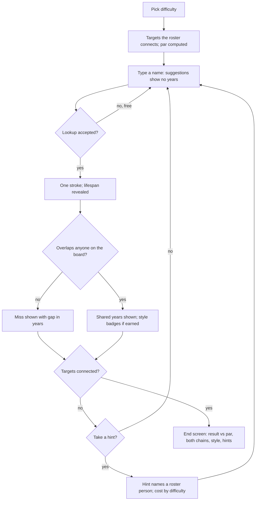

# Core Loop v2 Round - Plan

## Goal Capsule

- **Objective:** A streamer can win a round with a pick their chat did not see coming, and anyone watching can tell from the screen how good that pick was.
- **Product authority:** This plan defines one round: strokes, par, hidden dates, the overlap reveal, style, hints and the end screen (issue #54, round scope). The daily puzzle (#58), share card and challenge links (#59), suggestion picks (#60) and versus (#61) build on the round and are not active scope.
- **Open blockers:** None.

---

## Product Contract

### Summary

Each round becomes golf against par, where par is the shortest chain the game can build from its own roster of well-known people.
Lifespans stay hidden until a person is placed; placing them reveals the years they shared with everyone they overlap, or how far they missed.
Clutch overlaps and long bridges earn style badges that only break ties, hints cost more as difficulty rises, and the end screen sets the player's chain beside the par chain.

### Problem Frame

The game has no benchmark. The score is the count of people added (`src/app/page.tsx:123`), judged against fixed bands where 3 or fewer is "Expert historian" (`src/lib/components/ui/WinModal.tsx:39`). Two intermediates between Cleopatra and Einstein earn the same message as two between Lincoln and Darwin, so neither the player nor chat can tell whether a round was good.

The answer leaks before the player commits. Autocomplete shows each person's Wikipedia short description (`src/lib/components/ui/SearchBar.tsx:111`), and those descriptions often carry the dates: "Roman general and dictator (100–44 BC)", "Pharaoh of Egypt from 51 to 30 BC". The round turns into planning a route from visible data instead of remembering when people lived.

Nothing marks the moment a pick lands. A placed person is sorted into the timeline and coloured; the overlap that made the pick work is never stated. That overlap is the product's whole position (STRATEGY.md: "score the overlap itself"). The streamer research found that clip-worthy moments in GeoGuessr-style games come from a reveal after commitment, measured against a benchmark the audience already understands.

The flex this game should reward is specialist knowledge: someone who lived a hundred years around 1500, a figure from the thin centuries between 600 and 1000 CE, two lives that overlapped by months. The current round gives that knowledge no stage.

---

<!-- ce-section: work-relationships -->
## How This Work Fits Together

This plan covers the round. The breakdown below is the current understanding, not a committed roadmap.

- Existing issues this round absorbs as implementation pieces:
  - #57 par and best chain: implements R2–R6 and the par chain in R21.
  - #56 overlap reveal: implements R9–R11.
  - #51 contemporary hints: superseded by R18–R19; hints come from the roster instead of search results.
  - #64 one score scale: resolved by R6 and R23.
- #55 lifespan bars and the gap left to bridge: can proceed independently of this plan.
- #63 zoom and #66 mobile and stream layout: can proceed independently of this plan.
- #65 on-screen rules: shares this plan's rules; its copy must describe strokes, par, hidden dates and hint costs.
- Later modes:
  - #58 daily puzzle: depends on par (R2) as the shared benchmark.
  - #59 share card: depends on the result line and end screen (R6, R21).
  - #60 suggestion picks: depends on hidden dates (R7); picks must be dateless too.
  - #61 versus: depends on the style tiebreaker (R17).
- #43 PostHog: enables the "completed sessions" metric; a completed round is one that reaches R20's end condition.
- #52 target selection: still to decide whether difficulty should be defined by par instead of birth-year gap.

---

### Key Decisions

- **Golf against par, with style kept separate.** (session-settled: user-directed — chosen over a points total where high score wins, and over golf with no bonuses: keeps the puzzle pure while still giving niche picks visible credit.) Governs R2, R6, R17.
- **Every placed person is a stroke; rejected entries are free.** (session-settled: user-approved — chosen over counting only the final chain with three strikes, and over counting only the final chain with free misses: wrong-era guesses must cost something or spamming names wins.) Governs R1.
- **Lifespans hidden until placed.** (session-settled: user-approved — chosen over showing dates in autocomplete and over letting a hint reveal dates: knowing when people lived is the skill being shown off.) Governs R7, R8.
- **All four style flexes belong to the round's design: deep cut, clutch overlap, real connection, long bridge.** (session-settled: user-directed — chosen over a subset: each rewards a different kind of history knowledge.) Governs R12, R13.
- **Style only breaks ties.** (session-settled: user-approved — chosen over a separate style leaderboard and over display-only badges: style never beats a lower stroke count.) Governs R17.
- **Approximate dates keep links valid but earn no date-based style.** (session-settled: user-approved — chosen over treating "c." dates as exact, and over widening them into ranges: a clutch overlap built on rough dating is an artefact.) Governs R16.
- **No stroke cap and no clock.** (session-settled: user-directed — chosen over ending the round at par + 4 and over a time limit: a bad round is a high score, not a bust, and thinking aloud is the content.) Governs R20.
- **Hint cost scales with difficulty.** (session-settled: user-directed — chosen over a flat one-stroke hint, over free / +1 / no hints, and over free / free / +1: help should cost more as the player claims more skill.) Governs R19.
- **The first slice ships clutch overlap and long bridge; deep cut and real connection follow.** The two shipped flexes need only dates the game already has; the deferred two need new per-person data from a rate-limited API. Governs R12, R13.
- **Par counts only well-known people.** Knowing someone outside the roster is the way to beat par, which rewards obscure knowledge before the deep cut badge exists. Governs R2, R4.
- **One roster feeds par, hints and the par chain.** A hint then always names someone par could have used, and the end screen compares against the same source. Governs R2, R18, R21.
- **Misses are revealed, not just counted.** "Missed by 18 years" is a stream moment and costs nothing beyond date arithmetic. Governs R10.
- **Difficulty keeps today's target gaps.** Easy 200–700, Medium 600–1400 and Hard 1200+ years apart (`src/lib/services/TargetSelectionService.ts:200`); hint cost is the only new difficulty lever. Governs R19.

---

### Requirements

**Strokes and par**

- R1. Every person placed on the timeline is one stroke, whether or not they end up on the final chain; entries the game rejects (not found, not a person, no dates, duplicates, lookup failures) cost nothing.
- R2. Each round has a par: the fewest roster people (R4) needed to connect the two targets.
- R3. Par and the running stroke count stay visible for the whole round.
- R4. The roster holds only well-known people with reliable dates from Wikimedia, so knowing someone less famous is how a player beats par.
- R5. A target pair is offered only when the roster connects it and the two targets' lives do not already overlap, so par is always at least 1.
- R6. The result reads as strokes relative to par, using golf names for eagle (−2), birdie (−1), par and bogey (+1), and the signed difference otherwise.

**Hidden dates**

- R7. Until a person is placed, no year tied to them appears anywhere the player looks while choosing, including in autocomplete descriptions.
- R8. The two targets' lifespans are visible from the start of the round.

**The reveal**

- R9. Placing a person reveals their lifespan and how many years they shared with each overlapping person already on the board, with the overlaps that extend or complete the chain called out first.
- R10. A placement that overlaps nobody is revealed as a miss, showing the gap in years to the nearest life on the board.
- R11. Two lives that share only part of one calendar year count as overlapping and are shown as overlapping by less than a year.

**Style**

- R12. Clutch overlap: a link on the final chain whose two lives share 5 years or fewer.
- R13. Long bridge: a person on the final chain who lived 90 years or more.
- R14. Only people and links on the final chain earn style; placements off the chain earn none.
- R15. When several shortest chains exist through the player's placements, the one earning the most style counts.
- R16. Links that use approximate ("c.") years are valid, but clutch overlap and long bridge are earned only when every year involved is exact.
- R17. Style shows as badges on the reveal and the end screen and never changes the golf result; when two results on the same puzzle are compared, fewer strokes win and style breaks ties.

**Hints**

- R18. A hint names one roster person who would extend the player's progress toward connecting the targets, without revealing that person's dates.
- R19. Hint cost follows difficulty: on Easy hints are free and unrecorded; on Medium they are free but counted on the end screen; on Hard each hint adds one stroke.

**End of round**

- R20. The round is complete when the chain connects the targets; no stroke count or clock ends it.
- R21. The end screen shows strokes, par, the result (R6), the player's chain with shared years on each link, style earned, hints used where R19 records them, and the par chain.
- R22. Beating par is celebrated more loudly than matching it, and when the player's chain differs from the par chain both are shown side by side.
- R23. The fixed score bands are removed; every score message is relative to par.

---

### Key Flows

- F1. Playing a round
  - **Trigger:** The player picks a difficulty.
  - **Steps:** The game picks targets the roster connects and computes par. The player types a name; suggestions carry no years. An accepted lookup costs a stroke and triggers the reveal: shared years with each overlapping person, or the size of the miss, plus any style earned. The player may take a hint at the difficulty's price. This repeats until the chain connects.
  - **Outcome:** The end screen shows the result against par and both chains.
  - **Covered by:** R1–R23.

---

### Acceptance Examples

- AE1. **Covers R9, R12.** Given Jane Austen (1775–1817) on the board, when the player places Charles Dickens (1812–1870), the reveal shows they shared 5 years and, if the link is on the final chain, it earns clutch overlap.
- AE2. **Covers R11, R12.** Given Michelangelo (1475–1564) on the board, when the player places Galileo Galilei (1564–1642), the link is valid, shows as overlapping by less than a year, and earns clutch overlap if it is on the final chain.
- AE3. **Covers R10, R1.** Given only Mozart (1756–1791) and the targets on the board, when the player places Abraham Lincoln (1809–1865) and Lincoln overlaps nobody, the reveal shows a miss by 18 years and the stroke still counts.
- AE4. **Covers R13, R14.** Given Bernard de Fontenelle (1657–1757) is placed, when he sits on the final chain he earns long bridge; when the final chain routes around him he earns nothing.
- AE5. **Covers R16.** Given Johannes Gutenberg with an approximate birth year, when he links to someone with 3 shared years, the link counts toward the chain but earns no clutch overlap.
- AE6. **Covers R1.** When the player enters "Rome", or a name already on the board, the entry is rejected and the stroke count does not change.
- AE7. **Covers R19, R1.** Given a Hard round, when the player takes one hint and places the hinted person, the stroke count rises by 2. On Medium the same actions add 1 stroke and the end screen records 1 hint. On Easy they add 1 stroke and no hint is recorded.
- AE8. **Covers R7.** When the player types "Cleopatra", the suggestion reads like "Pharaoh of Egypt" and shows no year, not "Pharaoh of Egypt from 51 to 30 BC".
- AE9. **Covers R6, R22.** Given par is 3, when the player connects the targets with 2 placed people, the result reads "−1, birdie" and the end screen shows the player's chain beside the par chain.
- AE10. **Covers R5.** When a candidate target pair already overlaps, or the roster cannot connect it, the pair is never offered.

---

### Success Criteria

- A viewer told nothing about the rules can say, from the reveal alone, whether a pick connected and by how many years.
- In playtests of this slice, rounds that beat par use at least one person from outside the roster, which shows par is beaten by knowledge rather than luck.
- Clutch overlap and long bridge each appear in some rounds but not in most, so the badges stay worth showing off.

---

### Scope Boundaries

**Deferred for later**

- Deep cut style, which needs a count of Wikipedia language editions for every person.
- Real connection style, which needs Wikidata relationship statements (teacher, student, spouse, rival and similar).
- A give-up button that reveals the par chain; New Game remains the exit.
- Lifespan bars across the whole timeline and a "gap left to bridge" readout (#55).
- Defining difficulty by par instead of birth-year gap (#52).
- Daily puzzle, share card, suggestion picks and versus (#58–#61); the style tiebreaker first matters in these.

**Outside this product's identity**

- A stroke cap or time limit that can end a round in failure.
- Showing lifespans before the player commits a stroke.
- Entries that are not people.

---

### Dependencies / Assumptions

- Overlap uses the existing contemporaries rule, where years are inclusive (`src/lib/utils/ChainAnalyzer.ts:16`), and par reuses the existing shortest-path search (`src/lib/utils/ChainAnalyzer.ts:77`).
- Year 0 is not skipped yet (#53), so shared-year counts across 1 BCE to 1 CE are off by one; this is accepted until #53 lands.
- Living people count as alive through the current year, as lookups already record them.
- Wikimedia rate-limits hard, so building the roster must not cost hundreds of live requests per round.

---

### Outstanding Questions

**Deferred to Planning**

- How the roster is built, stored and refreshed, how many people it holds, and what "well-known" means as a number (for example a Wikipedia language-edition threshold).
- Whether par is computed in the browser for each round or ahead of time for each target pair.
- Whether the 5-year clutch and 90-year long-bridge thresholds produce the frequency in Success Criteria once tested against the roster.
- How dateless descriptions are produced: removing years from short descriptions, or using a different description source.
- How the reveal is presented (motion, placement of the shared-years figure) and how many overlaps to list when a person overlaps many.

---

### Sources / Research

- STRATEGY.md: positioning "score the overlap itself", people-only and Wikimedia-only boundaries, streamers as the main channel.
- docs/audits/2026-11-02-current-state-audit.md: as-built rules, score display and hint defects.
- docs/research/2026-11-02-streamer-guessing-games.md: reveal-after-commitment and closeness scoring in GeoGuessr-style streams.
- src/lib/services/WikipediaService.ts:154 and src/lib/components/ui/SearchBar.tsx:111: autocomplete shows Wikipedia short descriptions; src/lib/services/__fixtures__/wikimedia-responses.json shows dates inside them.
- src/lib/components/ui/DetailPanel.tsx:34: current hints come from `findContemporaries`, which returns year articles (#51).
- src/lib/services/TargetSelectionService.ts:200: current difficulty gaps.
