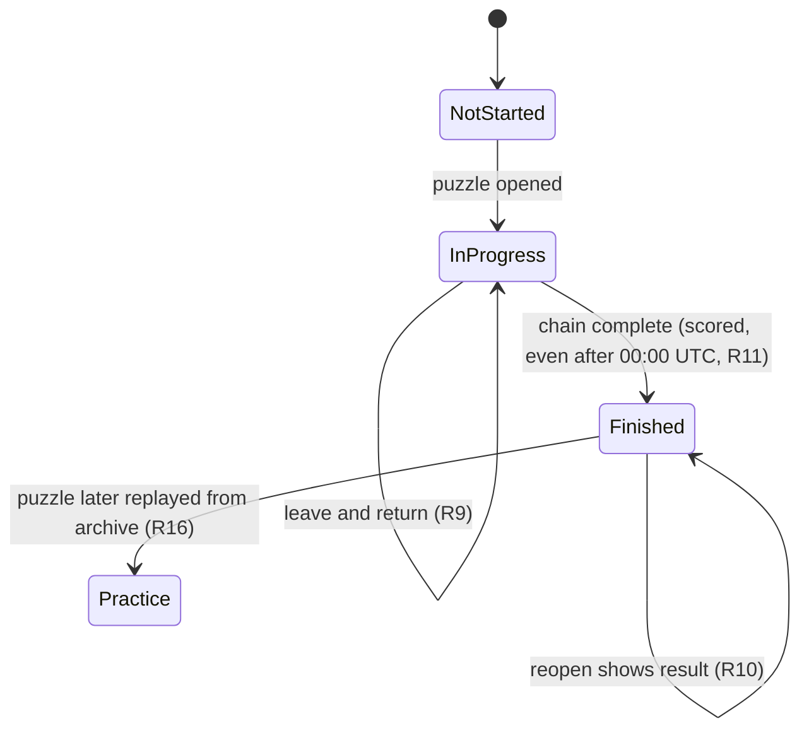

# Daily Shared Puzzle - Plan

## Goal Capsule

- **Objective:** On any given day, every player gets the same History Links puzzle, so a streamer, their chat and other streamers can compare results against the same par and link each other to it by number.
- **Product authority:** This plan defines the daily puzzle (issue #58). The rules of a round stay as defined in `docs/plans/2026-11-05-2214-feat-core-loop-v2-round-plan.md`, and difficulty bands as defined in `docs/research/2026-11-06-difficulty-balancing.md`. Share card and challenge links (#59) and one-answer puzzles (#81) are not active scope.
- **Open blockers:** None.

---

## Product Contract

### Summary

One daily puzzle for everyone, numbered from launch and switching at 00:00 UTC, with difficulty set by the weekday. The site opens on today's puzzle, and free play becomes the secondary option. Each browser gets one scored attempt per puzzle; past puzzles stay playable from their link as practice.

### Problem Frame

Every History Links round today is random and private. A streamer who says "I got it in 3, par 4" gives chat nothing to check or try, and two streamers cannot race the same puzzle. The streamer research found that the closest games streamers play (Hollywoodle, Movie to Movie) are dailies, and that "everyone gets the same puzzle" is what lets a streamer compare with chat and with other streamers (`docs/research/2026-11-02-streamer-guessing-games.md`, sections 2 and 3). The strategy's viewer-to-player metric counts players who arrive through a streamer's daily code or challenge link (`STRATEGY.md`), so without a shared puzzle there is nothing for that metric to measure.

### Actors

- A1. Streamer: plays today's puzzle live and tells chat the puzzle number and their result.
- A2. Viewer: plays the same puzzle in their own browser, during or after the stream, often from a link the streamer posted.

### Key Decisions

- **Difficulty rotates by weekday.** A weekly rhythm gives streamers a talking point and spreads results on most days, where Easy every day would leave most players at par. (session-settled: user-approved — chosen over Medium every day, three dailies a day, and Hard every day: one shared puzzle with a weekly ramp keeps "today's puzzle" one thing while varying the challenge.) Governs R3.
- **Past puzzles are practice.** (session-settled: user-directed — chosen over a scored archive and over today-only: links keep working for late viewers and VOD watchers, while "today" stays the only scored puzzle.) Governs R15, R16.
- **The site opens on the daily.** (session-settled: user-approved — chosen over equal choices and over free play first: one obvious thing for streamers and chat to play builds the daily habit.) Governs R7.
- **One worldwide switch at 00:00 UTC.** At any moment there is one "today's puzzle" for a streamer and their whole chat, wherever chat is; the cost is that US players get the next day's puzzle in the evening (7pm ET, 4pm PT). Governs R1, R11.
- **Puzzles are fixed once published.** Links, practice replays and compared results all depend on puzzle #n never changing, so the schedule is decided ahead and does not move when the roster or target selection changes. Governs R4.
- **No stream mode.** Watching a streamer play spoils that day's puzzle, as with any daily; hiding the answer from viewers is not attempted.

### Requirements

**Puzzle identity and schedule**

- R1. There is exactly one daily puzzle per UTC date, and it switches at 00:00 UTC.
- R2. Puzzles are numbered consecutively, starting at #1 on launch day.
- R3. A puzzle's difficulty band follows its UTC weekday: Monday and Tuesday Easy, Wednesday and Thursday Medium, Friday to Sunday Hard.
- R4. A published puzzle's targets and par never change, including when the roster is rebuilt or target selection changes.
- R5. Daily targets come from the same best-known pool as free play and fit their day's band (R3); a target pair never repeats, and no target person reappears within 14 days.
- R6. A puzzle whose date has not arrived cannot be opened or seen.

**Playing the daily**

- R7. Opening the site leads with today's puzzle, showing its number, weekday and difficulty, with free play offered as a secondary choice.
- R8. A daily round follows the round rules unchanged: strokes, par, hidden dates, the placement reveal, hints priced by the day's difficulty, and the end screen.
- R9. Each browser has one scored attempt per puzzle; the attempt is saved as it goes, resumes when the player returns, and cannot be restarted.
- R10. Once today's attempt is finished, opening the puzzle shows that result instead of a new attempt.
- R11. An attempt started before the 00:00 UTC switch stays the scored attempt for its puzzle when finished after the switch.
- R12. Daily and free-play progress are saved separately, so starting, leaving or finishing one never overwrites the other.
- R13. The daily view and the daily end screen show a countdown to the next puzzle.
- R14. The daily end screen shows the puzzle number beside the result, so a player can say "#12, 3 strokes, par 4".

**Links and archive**

- R15. Every published puzzle has a stable link by number (`/daily/<n>`); today's link opens the scored attempt.
- R16. A past puzzle can be played from its link or from an archive list as practice: its result is shown and marked practice, and a scored result from when it was today stays the player's record.

**Measurement**

- R17. Analytics events from a daily round carry the puzzle number and whether the round is scored or practice, so completions per puzzle and arrivals through daily links can be counted.

A daily attempt moves through these states; practice play never touches the scored record:

### Key Flows

- F1. Streamer plays today's puzzle live
  - **Trigger:** A1 opens the site during a stream.
  - **Actors:** A1, A2
  - **Steps:** The site opens on today's puzzle (R7); A1 plays one scored attempt under the usual rules (R8, R9); the end screen shows "#n", the result against par and the countdown (R13, R14); A1 posts the `/daily/<n>` link (R15).
  - **Outcome:** Chat knows which puzzle to play and what score to beat.
  - **Covered by:** R7, R8, R9, R13, R14, R15
- F2. Viewer follows a streamer's link
  - **Trigger:** A2 opens `/daily/<n>` from chat or a VOD.
  - **Actors:** A2
  - **Steps:** If `n` is today's puzzle, A2 gets their scored attempt (R15); if it is a past puzzle, A2 plays it as practice (R16); if it is in the future, the puzzle is not shown (R6).
  - **Outcome:** A2 plays exactly the streamer's pair and par.
  - **Covered by:** R6, R15, R16
- F3. Returning player
  - **Trigger:** A2 comes back after leaving a daily or a free-play round unfinished.
  - **Actors:** A2
  - **Steps:** The daily resumes where it stopped (R9); free play resumes its own round from the free-play option (R12).
  - **Outcome:** Neither round is lost or restarted.
  - **Covered by:** R9, R12

### Acceptance Examples

- AE1. **Covers R1, R4, R5.** Given two browsers on 2026-12-03 UTC, when both open today's puzzle, they get the same pair and the same par.
- AE2. **Covers R1, R11.** Given a player who starts #12 at 23:50 UTC, when they finish at 00:10 UTC, the result is scored for #12, and the home view now offers #13.
- AE3. **Covers R3.** Given #12 falls on a Saturday, when it is published, its pair fits the Hard band (par 4–6, one or two options at the narrowest step).
- AE4. **Covers R9, R10.** Given a player finished today's puzzle, when they reload or reopen it, they see their result and no new attempt starts.
- AE5. **Covers R15, R16.** Given today is #13, when a viewer opens `/daily/12`, they play #12 as practice, and if they had a scored #12 result it is still their record.
- AE6. **Covers R6.** Given today is #13, when anyone opens `/daily/14`, the puzzle's targets are not shown.
- AE7. **Covers R12.** Given a free-play round in progress, when the player opens the daily, plays a few placements, and returns to free play, the free-play round is where they left it.

### Success Criteria

- AE1 and AE2 hold, which is issue #58's done-when.
- Daily completions per day and arrivals through `/daily/<n>` links can be read in PostHog once analytics (#43) is live.

### Scope Boundaries

**Deferred for later**

- A copyable result line, share card and challenge links (#59).
- One-answer puzzles as a weekly slot, such as Sundays, once one-answer puzzles exist (#81).
- "Born on this day" themed puzzles: the roster holds birth and death years only, not full dates.
- Streaks, personal stats history and leaderboards.
- A stream mode that hides the answer from viewers.
- A puzzle that switches at the player's local midnight.

**Outside this product's identity**

- Accounts or sign-in to hold a player's scored attempts (`STRATEGY.md`: no user accounts yet).

### Dependencies / Assumptions

- R17 depends on analytics (#43), which is built on branch `ccr-eb562100-0cl3wr` and not yet merged.
- Streamers will adopt a daily puzzle. The research found dailies in one streamer duel; wider adoption of comparable dailies is unverified (`docs/research/2026-11-02-streamer-guessing-games.md`, section 5).
- One scored attempt per browser is honour-based: clearing site data or using another browser gives another attempt. That is accepted without accounts.
- Each band has ample famous pairs for a non-repeating schedule: among the 400 best-known roster people, about 7,600 Easy, 1,100 Medium and 2,300 Hard pairs (measured 2026-11-06 on the committed roster).

### Outstanding Questions

**Deferred to Planning**

- How far ahead the schedule is generated, how it is extended, and how a roster rebuild is checked against already-scheduled puzzles.
- Whether practice progress is saved between visits.
- The launch date that becomes puzzle #1.
- Where the archive list sits relative to the daily view and free play.

### Sources / Research

- `docs/research/2026-11-02-streamer-guessing-games.md`: dailies streamers play and why a shared puzzle matters.
- `docs/research/2026-11-06-difficulty-balancing.md`: the Easy, Medium and Hard bands the rotation uses.
- `docs/plans/2026-11-05-2214-feat-core-loop-v2-round-plan.md`: the round rules a daily round follows (R8).
- `src/lib/utils/difficulty.ts`: the best-known pool and band check that free play uses today.
- `src/lib/hooks/useGameState.ts` and `src/app/page.tsx`: today one saved round exists, and a saved round skips the splash on load, which R7 and R12 change.
