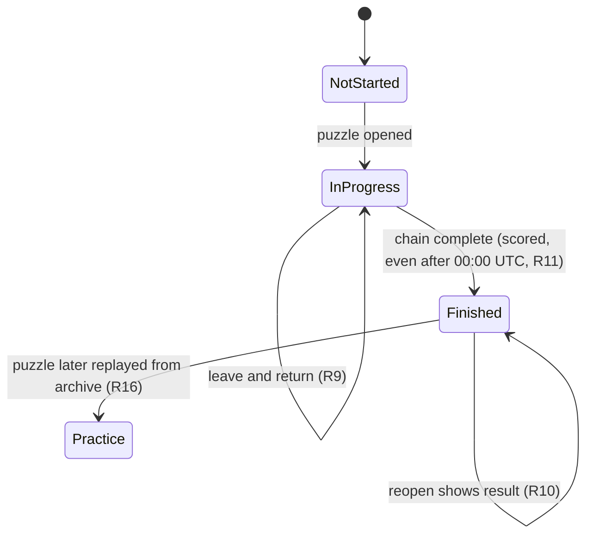
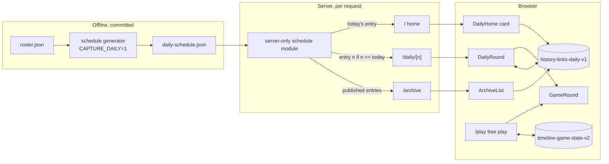
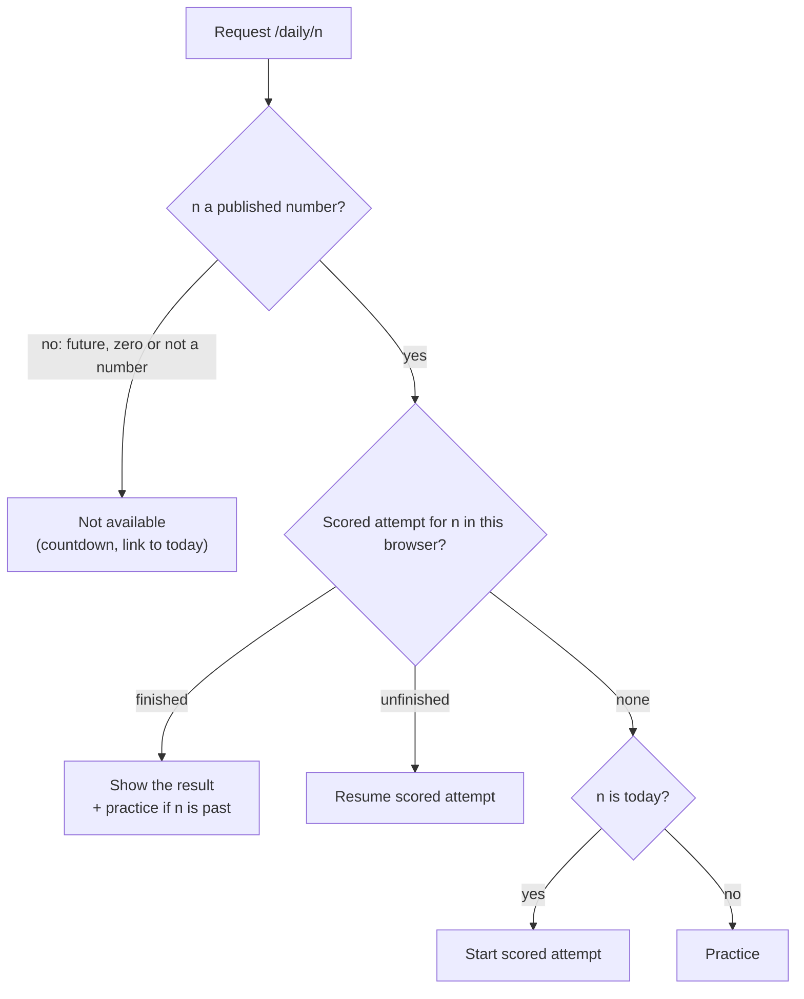

# Daily Shared Puzzle - Plan

## Goal Capsule

- **Objective:** On any given day, every player gets the same History Links puzzle, so a streamer, their chat and other streamers can compare results against the same par and link each other to it by number.
- **Means:** a committed, year-ahead schedule of self-contained puzzles, served only up to today by pages rendered on the server per request, and played through a round component shared with free play (KTD1, KTD2, KTD6).
- **Product authority:** This plan defines the daily puzzle (issue #58). The rules of a round stay as defined in `docs/plans/2026-11-05-2214-feat-core-loop-v2-round-plan.md`, and difficulty bands as defined in `docs/research/2026-11-06-difficulty-balancing.md`. Share card and challenge links (#59) and one-answer puzzles (#81) are not active scope. Within this plan, Requirements win on product behavior and Key Technical Decisions win on mechanism.
- **Execution profile:** Standard depth, one pull request, units U1–U8 in dependency order. The branch already carries the PostHog analytics commits (#43) that U7 extends.
- **Stop conditions:** Stop and ask if a requirement cannot be met as written. Examples: the deploy target cannot render pages per request, or free play cannot keep its current behavior and save after the round is extracted (U4).
- **Who finishes:** `ce-work` implements and verifies; a pull request is opened when the user asks, and the user merges.
- **Open blockers:** None. Choosing puzzle #1's date is a merge gate (Open Questions), not a start blocker.

---

## Product Contract

### Summary

One daily puzzle for everyone, numbered from launch and switching at 00:00 UTC, with difficulty set by the weekday. The site opens on today's puzzle, and free play becomes the secondary option. Each browser gets one scored attempt per puzzle; past puzzles stay playable from their link as practice.

### Problem Frame

Every History Links round today is random and private. A streamer who says "I got it in 3, par 4" gives chat nothing to check or try, and two streamers cannot race the same puzzle. The streamer research found that the closest games streamers play (Hollywoodle, Movie to Movie) are dailies, and that "everyone gets the same puzzle" is what lets a streamer compare with chat and with other streamers (`docs/research/2026-11-02-streamer-guessing-games.md`, sections 2 and 3). The strategy's viewer-to-player metric counts players who arrive through a streamer's daily code or challenge link (`STRATEGY.md`), so without a shared puzzle there is nothing for that metric to measure.

### Actors

- A1. Streamer: plays today's puzzle live and tells chat the puzzle number and their result.
- A2. Viewer: plays the same puzzle in their own browser, during or after the stream, often from a link the streamer posted.

### Key Decisions

- **Difficulty rotates by weekday.** A weekly rhythm gives streamers a talking point and spreads results on most days, where Easy every day would leave most players at par. (session-settled: user-approved — chosen over Medium every day, three dailies a day, and Hard every day: one shared puzzle with a weekly ramp keeps "today's puzzle" one thing while varying the challenge.) Governs R3.
- **Past puzzles are practice.** (session-settled: user-directed — chosen over a scored archive and over today-only: links keep working for late viewers and VOD watchers, while "today" stays the only scored puzzle.) Governs R15, R16.
- **The site opens on the daily.** (session-settled: user-approved — chosen over equal choices and over free play first: one obvious thing for streamers and chat to play builds the daily habit.) Governs R7.
- **One worldwide switch at 00:00 UTC.** At any moment there is one "today's puzzle" for a streamer and their whole chat, wherever chat is; the cost is that US players get the next day's puzzle in the evening (7pm ET, 4pm PT). Governs R1, R11.
- **Puzzles are fixed once published.** Links, practice replays and compared results all depend on puzzle #n never changing, so the schedule is decided ahead and does not move when the roster or target selection changes. Governs R4.
- **No stream mode.** Watching a streamer play spoils that day's puzzle, as with any daily; hiding the answer from viewers is not attempted.

### Requirements

**Puzzle identity and schedule**

- R1. There is exactly one daily puzzle per UTC date, and it switches at 00:00 UTC.
- R2. Puzzles are numbered consecutively, starting at #1 on launch day.
- R3. A puzzle's difficulty band follows its UTC weekday: Monday and Tuesday Easy, Wednesday and Thursday Medium, Friday to Sunday Hard.
- R4. A published puzzle's targets and par never change, including when the roster is rebuilt or target selection changes.
- R5. Daily targets come from the same best-known pool as free play and fit their day's band (R3); a target pair never repeats, and no target person reappears within 14 days.
- R6. A puzzle whose date has not arrived cannot be opened or seen.

**Playing the daily**

- R7. Opening the site leads with today's puzzle, showing its number, weekday and difficulty, with free play offered as a secondary choice.
- R8. A daily round follows the round rules unchanged: strokes, par, hidden dates, the placement reveal, hints priced by the day's difficulty, and the end screen.
- R9. Each browser has one scored attempt per puzzle; the attempt is saved as it goes, resumes when the player returns, and cannot be restarted.
- R10. Once today's attempt is finished, opening the puzzle shows that result instead of a new attempt.
- R11. An attempt started before the 00:00 UTC switch stays the scored attempt for its puzzle when finished after the switch.
- R12. Daily and free-play progress are saved separately, so starting, leaving or finishing one never overwrites the other.
- R13. The daily view and the daily end screen show a countdown to the next puzzle.
- R14. The daily end screen shows the puzzle number beside the result, so a player can say "#12, 3 strokes, par 4".

**Links and archive**

- R15. Every published puzzle has a stable link by number (`/daily/<n>`); today's link opens the scored attempt.
- R16. A past puzzle can be played from its link or from an archive list as practice: its result is shown and marked practice, and a scored result from when it was today stays the player's record.

**Measurement**

- R17. Analytics events from a daily round carry the puzzle number and whether the round is scored or practice, so completions per puzzle and arrivals through daily links can be counted.

A daily attempt moves through these states; practice play never touches the scored record:



### Key Flows

- F1. Streamer plays today's puzzle live
  - **Trigger:** A1 opens the site during a stream.
  - **Actors:** A1, A2
  - **Steps:** The site opens on today's puzzle (R7); A1 plays one scored attempt under the usual rules (R8, R9); the end screen shows "#n", the result against par and the countdown (R13, R14); A1 posts the `/daily/<n>` link (R15).
  - **Outcome:** Chat knows which puzzle to play and what score to beat.
  - **Covered by:** R7, R8, R9, R13, R14, R15
- F2. Viewer follows a streamer's link
  - **Trigger:** A2 opens `/daily/<n>` from chat or a VOD.
  - **Actors:** A2
  - **Steps:** If `n` is today's puzzle, A2 gets their scored attempt (R15); if it is a past puzzle, A2 plays it as practice (R16); if it is in the future, the puzzle is not shown (R6).
  - **Outcome:** A2 plays exactly the streamer's pair and par.
  - **Covered by:** R6, R15, R16
- F3. Returning player
  - **Trigger:** A2 comes back after leaving a daily or a free-play round unfinished.
  - **Actors:** A2
  - **Steps:** The daily resumes where it stopped (R9); free play resumes its own round from the free-play option (R12).
  - **Outcome:** Neither round is lost or restarted.
  - **Covered by:** R9, R12

### Acceptance Examples

- AE1. **Covers R1, R4, R5.** Given two browsers on 2026-12-03 UTC, when both open today's puzzle, they get the same pair and the same par.
- AE2. **Covers R1, R11.** Given a player who starts #12 at 23:50 UTC, when they finish at 00:10 UTC, the result is scored for #12, and the home view now offers #13.
- AE3. **Covers R3.** Given #12 falls on a Saturday, when it is published, its pair fits the Hard band (par 4–6, one or two options at the narrowest step).
- AE4. **Covers R9, R10.** Given a player finished today's puzzle, when they reload or reopen it, they see their result and no new attempt starts.
- AE5. **Covers R15, R16.** Given today is #13, when a viewer opens `/daily/12`, they play #12 as practice, and if they had a scored #12 result it is still their record.
- AE6. **Covers R6.** Given today is #13, when anyone opens `/daily/14`, the puzzle's targets are not shown.
- AE7. **Covers R12.** Given a free-play round in progress, when the player opens the daily, plays a few placements, and returns to free play, the free-play round is where they left it.

### Success Criteria

- AE1 and AE2 hold, which is issue #58's done-when.
- Daily completions per day and arrivals through `/daily/<n>` links can be read in PostHog once analytics (#43) is live.

### Scope Boundaries

**Deferred for later**

- A copyable result line, share card and challenge links (#59).
- One-answer puzzles as a weekly slot, such as Sundays, once one-answer puzzles exist (#81).
- "Born on this day" themed puzzles: the roster holds birth and death years only, not full dates.
- Streaks, personal stats history and leaderboards.
- A stream mode that hides the answer from viewers.
- A puzzle that switches at the player's local midnight.

**Outside this product's identity**

- Accounts or sign-in to hold a player's scored attempts (`STRATEGY.md`: no user accounts yet).

**Considered and not built**

- Server-side checks that a scored attempt is genuine: attempts are honour-based (see Dependencies / Assumptions). Revisit if leaderboards (#59 or later) make scores worth faking.
- A generated stand-in puzzle when the schedule runs out: the schedule health check (KTD5) fails CI 30 days ahead instead. Revisit if that alarm is missed in practice.
- Reconciling one scored attempt open in two tabs: the later save wins. Revisit if players report lost progress.

### Dependencies / Assumptions

- R17 builds on analytics (#43), committed on this work's branch ahead of the daily and not yet on `main`.
- Streamers will adopt a daily puzzle. The research found dailies in one streamer duel; wider adoption of comparable dailies is unverified (`docs/research/2026-11-02-streamer-guessing-games.md`, section 5).
- One scored attempt per browser is honour-based: clearing site data or using another browser gives another attempt. That is accepted without accounts.
- Each band has ample famous pairs for a non-repeating schedule: among the 400 best-known roster people, about 7,600 Easy, 1,100 Medium and 2,300 Hard pairs (measured 2026-11-06 on the committed roster).

### Sources / Research

- `docs/research/2026-11-02-streamer-guessing-games.md`: dailies streamers play and why a shared puzzle matters.
- `docs/research/2026-11-06-difficulty-balancing.md`: the Easy, Medium and Hard bands the rotation uses.
- `docs/plans/2026-11-05-2214-feat-core-loop-v2-round-plan.md`: the round rules a daily round follows (R8).
- `src/lib/utils/difficulty.ts`: the best-known pool and band check that free play uses today.
- `src/lib/hooks/useGameState.ts` and `src/app/page.tsx`: today one saved round exists, and a saved round skips the splash on load, which R7 and R12 change.

---

## Planning Contract

**Product Contract preservation:** restructured, no scope change. The four "Deferred to Planning" questions are resolved in place by KTD4 (schedule horizon and extension), KTD8 (practice progress) and KTD7 (archive placement); puzzle #1's date moved to Open Questions as a merge gate. "Considered and not built" was added under Scope Boundaries. The analytics dependency line was updated now that #43 is on this branch.

### Key Technical Decisions

- KTD1. **Store each puzzle as a self-contained snapshot in a committed schedule.** An entry holds its number, UTC date, band, both targets, the par chain, and the option count at its narrowest step as measured when it was generated. Each person is stored in the roster's own row shape (QID, name, years, approximate flags), and par is the chain's length. A roster rebuild or a change to `pickTargets` then cannot alter a published puzzle. Rejected: picking each day's pair at runtime from a date seed, where a rebuild silently swaps published puzzles; storing QIDs only, where a rebuild can change par. Governs R4.
- KTD2. **Only the server reads the schedule, and only published puzzles reach the browser.** The home, daily and archive pages are server components rendered per request (`await connection()` from `next/server`, as documented in `node_modules/next/dist/docs/01-app/03-api-reference/04-functions/connection.md` for Next 16.4.5). They pass client components only entries dated on or before today's UTC date. The schedule module imports `server-only` (bundled by Next; installing it is optional per the Next 16 docs) and is never re-exported from the `@/lib` barrel, so a client import fails the build. Rejected: a lazily loaded client chunk like the roster, which would put a year of future answers in readable JavaScript and undercut the "shared, trustworthy puzzle" `STRATEGY.md` names. Governs R6.
- KTD3. **Number puzzles by whole UTC days since the schedule's first date.** Puzzle number = days between a date and the first entry's date, plus one. All date logic uses UTC calendar fields, and the weekday-to-band table (R3) lives in one function. Governs R1, R2, R3.
- KTD4. **Generate the schedule with an offline, append-only builder.** A pure generator takes the roster, the existing entries, a start date and a day count. It appends entries after the last existing date and never alters earlier ones. Each day's pair comes from `pickTargets` with a seed derived from the date, retried until the pair is new and neither person appeared in the previous 14 days. The pair is then snapshotted from `computePar`. A gated capture test (`CAPTURE_DAILY=1`, offline, reads the committed roster) writes `src/lib/data/daily-schedule.json` 365 days ahead, following the `roster.capture.test.ts` pattern. Governs R4, R5.
- KTD5. **An always-on health check fails CI 30 days before the schedule runs out.** It validates the committed schedule's shape, consecutive dates, numbering, bands, chain validity and repeat rules (U2 lists the checks). It checks every entry against its own snapshot only, never against the current roster, so a roster rebuild cannot fail CI over a published puzzle (KTD1). It also fails when fewer than 30 entries remain after today's UTC date. That failure is how a person learns the schedule needs extending; the message names the capture command. The test depends on the date by design. Governs R4, R5.
- KTD6. **Free play and the daily share one round component.** The round is moved out of `src/app/page.tsx` into `src/lib/components/GameRound.tsx`: the board, header, search, hints, reveal, win flow and round analytics. It takes the targets, difficulty, a par source (computed from the roster, or a fixed snapshot chain), a persistence adapter, labels, an exit action and an analytics context. Rejected: a second page copying the round, where the two copies of the rules would drift. Governs R8.
- KTD7. **Routes.**
  - `/` is the home: today's puzzle, the countdown, free play and the archive link.
  - `/play` is free play, today's page content minus the splash.
  - `/daily` redirects to today's number.
  - `/daily/[n]` is one puzzle.
  - `/archive` lists published puzzles with this browser's status for each.
  - `SplashScreen` is retired.

  Governs R7, R15, R16.
- KTD8. **Daily progress uses its own storage key, separate from free play.** `history-links-daily-v1` holds scored attempts by puzzle number plus one practice slot (the latest practice puzzle). Free play keeps `timeline-game-state-v2` untouched. A scored attempt saves its figures, hints, saved hint and finished flag, plus a result summary once finished. Finished attempts older than seven days shrink to their summary. Each full attempt carries several kilobytes of looked-up figures, so a year of daily play would otherwise approach the browser's storage quota and make every save, free play included, fail without warning. Pure record logic lives in `src/lib/utils/dailyProgress.ts`, and the browser storage hook in `src/lib/hooks/useDailyProgress.ts`. Governs R9, R10, R12, R16.
- KTD9. **What opening puzzle n does.**
  - If a scored attempt for n is finished, it shows that result; for a past puzzle it also offers practice.
  - If a scored attempt for n is unfinished, it resumes as scored, even after n has passed (R11).
  - Otherwise, if n is today on the server's UTC date, it starts the scored attempt.
  - Otherwise it opens as practice.

  The server has already refused future puzzles (KTD2). Governs R9, R10, R11, R16.
- KTD10. **Daily targets take their identity and years from the snapshot, and only their display data from Wikimedia.** Descriptions and images come from the same two `lookupPerson` calls free play makes. A failed lookup leaves them blank and the round still starts. Governs R4.
- KTD11. **Hints keep using the live roster; par comes from the snapshot.** `nextHint` runs against the client roster as in free play. After a roster rebuild a hint may name someone not on the par chain, which the round rules allow. Governs R8.
- KTD12. **The countdown runs to a server-supplied switch time.** The server passes the next 00:00 UTC as an ISO timestamp. A client countdown counts to it and refreshes the route at zero, so an open home or result page rolls over to the new puzzle. Governs R13.
- KTD13. **Round events gain a mode, puzzle number and scored flag.** Every round event gets `mode` (`free` or `daily`), `puzzle` (number or null) and `scored` (true, false or null). `game_started` fires when an attempt begins, not when one resumes. Existing free-play properties are unchanged. Governs R17.

### High-Level Technical Design

Where the schedule lives and how a puzzle reaches the browser (KTD1, KTD2, KTD6, KTD8):



Opening a puzzle (KTD2, KTD9):



### Assumptions

- Vercel renders the new server pages per request with no configuration change, as it does for any Next.js App Router project.
- Players' clocks are close to the server's. The countdown uses the browser clock against the server's switch time, so a wrong clock only shifts the countdown, never which puzzle is today.

### Risks

| Risk | Mitigation |
|---|---|
| Moving the round out of `page.tsx` changes free play | U4 moves code without changing behavior and re-runs the existing browser checks (win flow, legacy save, reveal, hints) on `/play` before any daily work builds on it. |
| The schedule leaks into the client bundle through the `@/lib` barrel | The `server-only` import fails the build; verification also searches the built client assets for a future entry's QID. |
| The date-dependent health check fails an unrelated PR | This is intended: the 30-day margin and a message naming the capture command make it a planned task, not a mystery. |
| Browser storage grows with every daily played | KTD8 compacts finished attempts older than seven days. |

### System-Wide Impact

- **Rendering:** the home, daily and archive pages are the first server-rendered routes. Each visit runs a small server render on Vercel instead of serving a static page. `CLAUDE.md`'s "no backend" line changes to "no backend service or database".
- **URLs:** free play moves from `/` to `/play`. Old bookmarks land on the home page. A saved free-play round keeps its key and resumes from "Free play".
- **Analytics:** round events gain three properties (KTD13), and PostHog's landing pageview records `/daily/<n>` arrivals.
- **Imports:** server code imports the schedule module by path, an explicit exception to the "`src/app` imports from `@/lib`" convention (U8 documents it).

### Open Questions

- **Merge gate:** puzzle #1 is the day this ships. Generate the schedule from the planned deploy date. If the merge happens after that date, regenerate before merging so #1 lands on launch day (R2).

---

## Output Structure

```text
src/
├── app/
│   ├── page.tsx                 # home (server): today's puzzle, countdown, free play, archive
│   ├── play/page.tsx            # free play
│   ├── daily/page.tsx           # redirect to today's number
│   ├── daily/[n]/page.tsx       # one puzzle (server gate, then DailyRound)
│   └── archive/page.tsx         # published puzzles
└── lib/
    ├── components/
    │   ├── GameRound.tsx        # the shared round
    │   ├── DailyRound.tsx       # scored / practice / result for one puzzle
    │   └── ui/                  # DailyHome, ArchiveList, Countdown (+ WinModal changes)
    ├── data/
    │   ├── daily-schedule.json  # committed snapshots, a year ahead
    │   └── dailySchedule.ts     # pure parse and lookup (testable)
    ├── server/daily.ts          # server-only wrapper used by the pages
    ├── services/
    │   ├── dailyScheduleBuild.ts
    │   └── daily.capture.test.ts
    ├── hooks/useDailyProgress.ts
    └── utils/
        ├── daily.ts             # calendar rules
        └── dailyProgress.ts     # attempt records and KTD9
```

---

## Implementation Units

### U1. Daily calendar rules

- **Goal:** pure functions for puzzle numbers, dates, weekday bands and the next switch time.
- **Requirements:** R1, R2, R3, R13; KTD3, KTD12.
- **Dependencies:** none.
- **Files:** `src/lib/utils/daily.ts`, `src/lib/utils/daily.test.ts`.
- **Approach:**
  1. Represent a puzzle date as a UTC calendar key (`YYYY-MM-DD`) and derive everything from it.
  2. Number and date convert both ways against the schedule's first date (KTD3).
  3. One function maps a UTC weekday to its band (R3).
  4. One function returns the next 00:00 UTC after a given instant (KTD12).
- **Patterns to follow:** pure rules beside `src/lib/utils/difficulty.ts`, tested like `difficulty.test.ts`.
- **Test scenarios:**
  - The first date is #1, the next day #2, and a date 365 days later #366.
  - 2026-12-31T23:59:59Z and 2027-01-01T00:00:00Z fall on consecutive puzzle numbers.
  - A leap day (2028-02-29) gets its own number, and 2028-03-01 follows it.
  - Covers AE3. Every weekday maps to its band: Monday and Tuesday Easy, Wednesday and Thursday Medium, Friday to Sunday Hard.
  - The next switch after 23:59:59Z is one second later; after exactly 00:00:00Z it is 24 hours later.
  - A date before the first date has no puzzle number.
- **Verification:** the date and band rules hold for any instant, independent of the machine's time zone.

### U2. Schedule generation, committed schedule and health check

- **Goal:** a year of snapshot puzzles in `src/lib/data/daily-schedule.json`, generated offline, readable only on the server, and checked in CI.
- **Requirements:** R1, R2, R3, R4, R5, R6; KTD1, KTD2, KTD4, KTD5.
- **Dependencies:** U1.
- **Files:**
  - `src/lib/services/dailyScheduleBuild.ts` and `src/lib/services/dailyScheduleBuild.test.ts`;
  - `src/lib/services/daily.capture.test.ts`;
  - `src/lib/data/daily-schedule.json`;
  - `src/lib/data/dailySchedule.ts` and `src/lib/data/dailySchedule.test.ts`;
  - `src/lib/server/daily.ts`.
- **Approach:**
  1. `dailyScheduleBuild.ts` holds the pure generator (KTD4), reusing `pickTargets`, `computePar` and the roster row shape from `src/lib/data/roster.ts`.
  2. `daily.capture.test.ts` is skipped unless `CAPTURE_DAILY=1`, like `roster.capture.test.ts`. It takes the start date from an environment variable (defaulting to today, UTC) and writes the file.
  3. `dailySchedule.ts` holds pure functions over entries passed in ("entry for n", "published entries up to a date", the route gate). It never imports the JSON, so a client import cannot pull the schedule into the browser. Tests read the JSON directly.
  4. `src/lib/server/daily.ts` imports `server-only` and the JSON, and is the only module that does; it serves the pages through the pure functions. Nothing in `src/lib/index.ts` exports it (KTD2).
  5. `dailySchedule.test.ts` is the health check (KTD5). It checks:
     - dates are consecutive from the first entry, and each number matches its date;
     - each band matches its weekday;
     - every par-chain link overlaps its neighbours, the chain connects the targets, and par is the chain's length;
     - the stored par and narrowest-step count fit the entry's band;
     - no pair repeats, and no person reappears within 14 days;
     - at least 30 entries remain after today's UTC date.
- **Patterns to follow:** `src/lib/services/roster.capture.test.ts` (gated builder), `src/lib/data/roster.test.ts` (checks on a committed data file).
- **Test scenarios:**
  - Covers AE1. The generator run twice with the same roster, start date and seed produces identical entries.
  - Appending 10 days to an existing 5-day schedule leaves the first 5 entries byte-identical.
  - No pair repeats and no target person appears twice within any 14-day window across a generated 365 days.
  - Covers AE3. A generated Saturday entry fits the Hard band and a Monday entry the Easy band.
  - Each entry's par equals its chain length, and each chain link shares at least part of a year with its neighbours.
  - The health check fails on a hand-built schedule with a gap day, a wrong band, a broken chain, a repeated pair or fewer than 30 days remaining. This needs a validation function the test can call on fixtures, not only on the committed file.
  - "Published entries up to a date" excludes every entry after that date.
  - The health check still passes for an entry whose people are no longer on the roster, because it reads only the snapshot.
- **Verification:** the committed file covers 365 days from the start date and passes the health check. `npm run build` fails if a client component imports `src/lib/server/daily.ts`.

### U3. Daily progress storage

- **Goal:** a per-browser record of scored attempts and one practice slot, with the opening decision from KTD9.
- **Requirements:** R9, R10, R11, R12, R16; KTD8, KTD9.
- **Dependencies:** U1.
- **Files:** `src/lib/utils/dailyProgress.ts`, `src/lib/utils/dailyProgress.test.ts`, `src/lib/hooks/useDailyProgress.ts`.
- **Approach:**
  1. Pure functions normalize stored data (unknown shapes become an empty record, like `normalizeSavedState`). They record progress, finish an attempt with its result summary, compact finished attempts older than seven days, and decide what opening puzzle n does (KTD9).
  2. The hook reads and writes `history-links-daily-v1` with the same debounce and error handling as `useAutoSave`. It never touches `timeline-game-state-v2`.
- **Patterns to follow:** `src/lib/hooks/useGameState.ts` and its `normalizeSavedState` test.
- **Test scenarios:**
  - Opening today's puzzle with no record starts a scored attempt.
  - Covers AE2. An unfinished scored attempt for #12, opened when today is #13, resumes as scored and finishes as #12's record.
  - Covers AE4. A finished scored attempt for today opens as its result, and no new attempt is created.
  - Covers AE5. Opening #12 when today is #13 with a finished #12 record shows that result and offers practice; practice progress goes to the practice slot and leaves #12's record unchanged.
  - Starting practice on a different puzzle replaces the single practice slot.
  - A finished attempt eight days old compacts to its summary, and a six-day-old one keeps its figures.
  - Malformed or missing stored data normalizes to an empty record without throwing.
- **Verification:** every KTD9 branch has a test, and the free-play key never appears in this module.

### U4. Shared round component; free play moves to `/play`

- **Goal:** the round lives in one component that free play and the daily both render, with free play unchanged for players.
- **Requirements:** R8, R12; KTD6, KTD7.
- **Dependencies:** none (lands before U5).
- **Files:** `src/lib/components/GameRound.tsx`, `src/app/play/page.tsx`, `src/app/page.tsx`, `src/lib/index.ts`.
- **Approach:**
  1. Move the round state, effects, handlers and JSX from `src/app/page.tsx` into `GameRound` without changing behavior. That covers figures, reveal, hints, the win check, the board lock and analytics.
  2. Expose the KTD6 inputs as props. Free play passes a roster-computed par and the existing `timeline-game-state-v2` persistence.
  3. `src/app/play/page.tsx` keeps the difficulty picker, loading, restore and "New Game" around `GameRound`.
  4. Until U6 replaces it, `src/app/page.tsx` sends players to `/play`, so free play stays reachable at every commit.
- **Execution note:** behavior-preserving move. Re-run the existing browser checks on `/play` (a winning placement with the reveal before the end screen, a legacy unlinkable saved round, hints and reload) before U5 starts.
- **Patterns to follow:** the current `src/app/page.tsx`; keep its `'use client'` boundary on `GameRound`.
- **Test scenarios:** Test expectation: none -- a code move with no new rules; the existing unit suites must stay green, and the browser checks above are the regression proof.
- **Verification:** on `/play`, a full free round plays as before. A free round saved before this change resumes from "Free play", and strokes, par, hints, reveal and end screen are unchanged.

### U5. Daily puzzle page

- **Goal:** `/daily/[n]` serves one published puzzle as a scored attempt, a resumed attempt, a result or practice, and `/daily` points at today.
- **Requirements:** R4, R6, R8, R9, R10, R11, R13, R14, R15, R16; F1, F2; KTD2, KTD9, KTD10, KTD11, KTD12.
- **Dependencies:** U1, U2, U3, U4.
- **Files:**
  - `src/app/daily/[n]/page.tsx` and `src/app/daily/page.tsx`;
  - `src/lib/components/DailyRound.tsx`;
  - `src/lib/components/ui/Countdown.tsx`;
  - `src/lib/components/ui/WinModal.tsx`;
  - tests in `src/lib/data/dailySchedule.test.ts` (the gate) and `src/lib/utils/dailyProgress.test.ts` (the adapter). These catch the published-or-not rule and the storage round-trip, not the page wiring, which the browser checks cover.
- **Approach:**
  1. The page awaits `connection()`, parses `n` and asks `src/lib/server/daily.ts` for the entry if n is published. The gate itself is a pure function in `src/lib/data/dailySchedule.ts`; the persistence adapter `DailyRound` hands to `GameRound` is built from pure functions in `src/lib/utils/dailyProgress.ts`. Otherwise it renders a "not available yet" view with the countdown and a link to today; that view shows no targets (R6).
  2. It passes the entry, today's number and the next switch time to `DailyRound`.
  3. `DailyRound` applies KTD9 through `useDailyProgress`. It builds the two targets from the snapshot plus `lookupPerson` display data (KTD10) and renders `GameRound` with the snapshot par chain and the daily persistence adapter.
  4. Header and end screen show "#n", "Practice" when it applies, and the countdown on the scored and result views (R13, R14).
  5. The exit action goes home, with no reset prompt, because progress is saved.
  6. `/daily` redirects to today's number.
- **Patterns to follow:** the Next 16 `connection` and `redirect` docs under `node_modules/next/dist/docs/01-app/03-api-reference/04-functions/`; dynamic route `params` are a Promise in this version.
- **Test scenarios:**
  - Covers AE6. The route's pure gate (published-or-not for a parsed `n` against a date) rejects tomorrow's number, zero, negatives and non-numbers.
  - The daily persistence adapter round-trips a placement and a hint through the KTD8 record without writing the free-play key.
  - Browser checks for this unit are in the Verification Contract.
- **Verification:** each branch of the opening-a-puzzle diagram is reachable in the browser. A future number never shows target names, including in the page source.

### U6. Home page and archive

- **Goal:** the site opens on today's puzzle, and the archive lists published puzzles with this browser's status.
- **Requirements:** R7, R12, R13, R15, R16; F1, F3; KTD7.
- **Dependencies:** U1, U2, U3, U5.
- **Files:**
  - `src/app/page.tsx` and `src/app/archive/page.tsx`;
  - `src/lib/components/ui/DailyHome.tsx` and `src/lib/components/ui/ArchiveList.tsx`;
  - `src/lib/utils/dailyProgress.ts` and `src/lib/utils/dailyProgress.test.ts` (a puzzle-status helper; the tests catch wrong labels, not layout);
  - `src/lib/components/ui/SplashScreen.tsx` (removed), `src/lib/index.ts`.
- **Approach:**
  1. The home is a server page that passes today's number, date, weekday, band and switch time to `DailyHome`.
  2. `DailyHome` shows "Play", "Resume" or "See result" from one pure status helper over the KTD8 record, plus the countdown.
  3. It offers "Free play", or "Resume free play" when a free round is saved, and links to the archive.
  4. The archive page passes published entries, newest first, to `ArchiveList`, which marks each as unplayed, scored (with result) or in progress.
- **Patterns to follow:** the current `SplashScreen` styling for the home card; `DIFFICULTY_OPTIONS` colours in the free-play picker for band badges.
- **Test scenarios:**
  - With no record, today's puzzle reads "Play" and a past puzzle reads "unplayed".
  - An unfinished scored attempt reads "Resume", including for yesterday's puzzle (R11).
  - A finished scored attempt reads "See result" with its strokes and par, also after it compacts to a summary.
  - A puzzle played only as practice reads "practice", never as a scored result.
  - The home and archive layouts are covered by the browser checks in the Verification Contract.
- **Verification:** a first visit shows today's number, weekday and band with "Play". After playing, the home shows "See result", and the archive marks that puzzle scored.

### U7. Analytics for daily rounds

- **Goal:** round events say which mode, puzzle and attempt kind they came from.
- **Requirements:** R17; KTD13.
- **Dependencies:** U4, U5.
- **Files:** `src/lib/utils/roundEvents.ts`, `src/lib/utils/roundEvents.test.ts`, `src/lib/components/GameRound.tsx`, `DEPLOYMENT.md`.
- **Approach:**
  1. Add the KTD13 properties to the started, completed and abandoned helpers, and pass the round's analytics context from `GameRound`.
  2. Fire `game_started` only when an attempt is created, not on resume.
  3. Document the new properties and a "completions per puzzle" insight in `DEPLOYMENT.md`.
- **Patterns to follow:** existing `roundStartedProps` and `roundCompletedProps` tests.
- **Test scenarios:**
  - A free round's started and completed properties carry `mode: free`, `puzzle: null` and `scored: null`, and every existing property is unchanged.
  - A scored daily round carries `mode: daily`, its puzzle number and `scored: true`; a practice round carries `scored: false`.
- **Verification:** with a PostHog key and debug logging, a daily round logs its events with the new properties, and resuming does not log a second `game_started`.

### U8. Project documentation

- **Goal:** the docs describe the routes, the schedule and how to extend it.
- **Requirements:** R4 (extending without changing published puzzles); KTD2, KTD4, KTD5.
- **Dependencies:** U2, U5, U6.
- **Files:** `CLAUDE.md`, `DEPLOYMENT.md`, `ROADMAP.md`.
- **Approach:**
  1. In `CLAUDE.md`, update the layout tree and data flow, and add the `CAPTURE_DAILY=1` command.
  2. Record the server-only schedule and its import exception to the `@/lib` rule (KTD2), and change "no backend or database" to "no backend service or database".
  3. Add a short "Extending the daily schedule" runbook to `DEPLOYMENT.md`, and mark #58 in progress in `ROADMAP.md`.
- **Test expectation:** none -- documentation.
- **Verification:** someone new to the repo can extend the schedule from `DEPLOYMENT.md` alone.

---

## Verification Contract

| Gate | Command or check | Proves |
|---|---|---|
| Unit tests | `npm test` | U1–U3 and U7 rules, the schedule health check (KTD5), and existing suites unchanged |
| Types | `npx tsc --noEmit` | the prop contracts between pages, `DailyRound` and `GameRound` |
| Lint | `npm run lint` | no new errors (existing warnings tracked in #44) |
| Build | `npm run build` | server and client boundaries hold (`server-only`), and every route compiles |
| Bundle | search the built client assets (`.next/static`) for the QID of an entry dated after the build day | KTD2: future puzzles are absent from client code |
| Browser | Playwright against `npx next start`, 390 px and 1440 px | the flows below |

Browser checks:

- Covers AE1. Two fresh browser contexts open `/` and `/daily/<today>` and see the same targets, par and number.
- Covers AE4. Finish today's puzzle (using a saved-state setup, as the earlier win check did); reload `/daily/<today>` and the home; both show the result, and no new attempt starts.
- Covers AE5. Open `/daily/<today-1>`: it plays as practice. With a finished record for that number, it shows the result first and the record is unchanged after practice.
- Covers AE6. `/daily/<today+1>`, `/daily/0` and `/daily/abc` show "not available", and the HTML contains neither target's name.
- Covers AE7. Start a free round on `/play`, open the daily and place someone, then return to "Free play": the free round resumes unchanged.
- Free play regression on `/play`: the winning reveal before the end screen, the board lock, the legacy unlinkable saved round showing par as "–", and the hint pricing per difficulty.
- The home shows today's number, weekday, band and countdown; the archive lists published puzzles newest first with statuses.

AE2 (the switch mid-attempt) and AE3 (weekday bands) are proven by U1–U3 unit tests with fixed clocks, since the server's clock cannot be moved in a browser check.

---

## Definition of Done

- Every requirement R1–R17 is met, and AE1–AE7 are proven by the unit tests or browser checks named above.
- `npm test`, `npx tsc --noEmit`, `npm run lint` (0 errors) and `npm run build` pass, and the bundle check finds no future puzzle.
- `src/lib/data/daily-schedule.json` starts on the planned deploy day and covers 365 days (merge gate in Open Questions).
- Free play at `/play` behaves as before this work, including saved rounds.
- `SplashScreen` and any code left from abandoned approaches are removed; no debug flags or probe files remain.
- `CLAUDE.md`, `DEPLOYMENT.md` and `ROADMAP.md` are updated (U8).
- Per unit: U1–U3 and U7 have their listed tests passing; U4–U6 pass their browser checks; U8's runbook is followed once to extend the schedule by a day in a scratch run.
