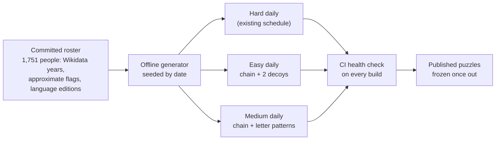

# Three Ways to Play - Plan

## Goal Capsule

- **Objective:** Players who cannot recall and type names fluently can play History Links every day, and streamers keep a competitive mode. Each player picks Easy, Medium or Hard, and each style has its own daily puzzle.
- **Product authority:** This plan, under `STRATEGY.md` (Users; Tracks: free text for streamers, picking for viewers). For Easy and Medium it replaces the meaning of difficulty in `docs/research/2026-11-06-difficulty-balancing.md`; Hard keeps those rules. The share card (#59) and versus (#61) are not active scope.
- **Open blockers:** None.

---

## Product Contract

### Summary

Easy, Medium and Hard become three ways to play instead of three pair hardnesses. Easy deals name cards, decoys included, to arrange between the two targets. Medium shows letter-count blanks to fill with the exact people on a fixed chain. Hard is today's typed game, scored against par. Each style gets its own daily puzzle, generated offline, frozen once published and checked in CI.

### Problem Frame

Today every round is free typing: the player must recall a name, spell it and know roughly when that person lived. That suits a streamer showing off, but it shuts out most of the people `STRATEGY.md` counts on: viewers watching on phones, chat, and anyone who recognises famous names without being able to produce them on demand. The current Easy, Medium and Hard only change how far apart the two targets are; the act of playing stays the same, so a player who struggles with recall has no easier way in.

### Key Decisions

- **The three styles are the difficulty scale.** One scale players already understand, rather than a pair hardness plus a separate style setting. Governs R1, R2. (session-settled: user-directed — chosen over keeping pair hardness as the difficulty with styles beside it: three styles are the new Easy, Medium and Hard)
- **Par exists only in Hard.** Easy and Medium have one fixed answer, so counting misses measures them better than strokes against par. Governs R9, R12. (session-settled: user-directed — chosen over scoring every style against par: par matters only for the competitive mode)
- **Three daily puzzles a day, one per style.** Separate puzzles mean finishing one style never spoils another. Governs R13, R15, R16. (session-settled: user-directed — chosen over one shared puzzle locked to the style you start in, the Wordle model: no spoilers, and every style keeps a scored attempt)
- **Medium's answers are the exact people on a fixed chain, shown as letter counts.** A pre-defined chain keeps every answer overlapping and makes the blanks a fair, guessable puzzle. Governs R6, R7, R8. (session-settled: user-directed — chosen over accepting anyone who fits a blank: the chain is pre-defined so all its people overlap)
- **Easy hands include decoys.** Decoys turn a sort into a puzzle. Governs R3, R4. (session-settled: user-directed — chosen over a hand of only the chain's people)
- **Easy and Medium score by misses.** Easy counts Checks, Medium counts wrong guesses and reveals. Governs R9. (session-settled: user-approved — chosen over stars or a plain solved/not result)
- **Fame by style.** Easy draws only on the best-known people; Medium may use the whole roster, so it plays harder. Governs R18. (session-settled: user-directed — chosen over famous-only chains for both styles and over reusing Hard's par chain)
- **The existing daily schedule becomes the Hard daily.** Puzzles #1 and #2 are already published and cannot change. Governs R14.

### Requirements

**Choosing a style**

- R1. The menu offers Easy, Medium and Hard for the daily puzzle and for free play, and each starts a puzzle in that style.
- R2. Every round and every result line names its style, for example "Daily #3 · Medium · 2 misses".

**Easy: arrange the cards**

- R3. The player gets the chain's middle people plus 2 decoys as shuffled name cards with years hidden, and one empty slot per middle person between the two gold targets.
- R4. Exactly one arrangement of the hand into the slots forms a valid chain, and decoys are well-known people born within the puzzle's span.
- R5. Check locks every card in its correct slot and turns it over to show its years; other cards return to the hand, and the round ends when every slot is correct.

**Medium: fill the blanks**

- R6. Only the two targets are shown; each middle person is a blank showing the letter count of each word of their name, without any bracketed disambiguation, and blanks can be filled in any order.
- R7. A guess is matched by person, not spelling, so a name that resolves to the blank's person fills it and the card turns over to show its years.
- R8. A guess that resolves to anyone else is a miss; when that person would also fit between the blank's neighbours, the message says they fit but the chain wants someone else.
- R9. Easy's score is the number of Checks (1 is perfect); Medium's is wrong guesses plus revealed people; both results show the count and one square per slot.
- R10. In Medium the wild card reveals one blank's person and counts as a miss; Easy has no wild card.

**Hard**

- R11. Hard is today's typed game unchanged: any valid chain counts, scored in strokes against par, with the current Hard wild card (+1 stroke).
- R12. Par is shown only in Hard.

**Daily puzzles**

- R13. Each UTC date has an Easy, a Medium and a Hard puzzle, all carrying that date's number (#n).
- R14. The Hard daily is the existing schedule, including its weekday ramp of pair hardness, and published Hard puzzles never change.
- R15. Easy and Medium dailies exist for every date from #1 (2026-11-07) onwards and never change once published.
- R16. Each browser gets one scored attempt per style per puzzle; later replays are practice, and the menu and archive show a status for each style.

**Making the puzzles**

- R17. Every puzzle, daily or free play, is generated from the committed roster, and a daily is seeded by its date and stored as a frozen copy of its people, years, chain and decoys.
- R18. Easy chains use only the 400 best-known people by Wikipedia language editions, Medium chains may use the whole roster, and both take the most famous of the shortest valid chains, with 2 to 4 people between the targets.
- R19. Neighbours in an Easy or Medium chain overlap, and where an approximate year sets either end of their shared stretch they must share at least 5 years.
- R20. A Medium puzzle is rejected when any other roster person who fits a blank has the same letter pattern as that blank's answer.
- R21. CI rechecks every Easy and Medium copy as it already checks Hard: R18, R19 and R20 hold, R4's single arrangement holds, no pair or recent target repeats, and at least 30 days are scheduled ahead.
- R22. Easy and Medium keep the hidden-dates rule: a person's years appear only once that person is correctly placed.

### Key Flows

- F1. An Easy round
  - **Trigger:** The player picks Easy for today's daily or for free play.
  - **Steps:** The two gold targets and the empty slots appear with the hand below. The player places cards and presses Check. Correct cards lock and show their years, the rest return, and the player repeats until every slot is right.
  - **Outcome:** The result shows the number of Checks and one square per slot.
  - **Covered by:** R3, R4, R5, R9, R22
- F2. A Medium round
  - **Trigger:** The player picks Medium.
  - **Steps:** The targets and the letter-count blanks appear. The player selects a blank and types a name. A match fills the blank and shows the years; anything else is a miss with a short message. The wild card can reveal a blank at the cost of a miss.
  - **Outcome:** The result shows the misses and one square per slot.
  - **Covered by:** R6, R7, R8, R9, R10, R22
- F3. Choosing today's style
  - **Trigger:** The player opens the menu.
  - **Steps:** Today's three dailies show with their status. Starting one opens that style's puzzle as a scored attempt; one already finished opens its result; replaying it is practice.
  - **Covered by:** R1, R13, R16

### Acceptance Examples

- AE1. **Covers R5, R9.** Given an Easy hand with three slots, when the player puts two chain people in their right slots and a decoy in the third and presses Check, then two cards lock and show their years, the decoy returns to the hand, and one Check is counted. A correct second Check ends the round at 2 Checks.
- AE2. **Covers R7.** Given a Medium blank whose answer is Isaac Newton, when the player types "Newton", then the blank fills with Isaac Newton and his years appear.
- AE3. **Covers R8.** Given a Medium blank whose neighbours both overlap someone who is not the answer, when the player types that person, then it counts as a miss and the message says they fit but the chain wants someone else.
- AE4. **Covers R16.** Given a player who finished Daily #3 Easy, when they open Daily #3 Medium, then it starts a scored attempt of its own; when they reopen Daily #3 Easy, then they see their result, and playing it again is practice.
- AE5. **Covers R14, R15.** Given Hard #1 published on 2026-11-07, when the three-style schedule ships, then Hard #1 is unchanged and Easy #1 and Medium #1 exist for the same date.
- AE6. **Covers R19.** Given Geoffrey Chaucer (c. 1343 – c. 1400) and someone born in 1398, when the generator considers them as neighbours, then the link is rejected, because the approximate year sets the end of their shared stretch and they share fewer than 5 years.
- AE7. **Covers R20.** Given a Medium blank whose answer has two words of 5 and 6 letters, when another roster person who also fits that blank has the same 5-6 pattern, then the puzzle is rejected and the generator tries another.

### Success Criteria

- The generator produces Easy and Medium puzzles for every date a year ahead without manual fixes.
- A full Easy round can be played without a keyboard.
- Hard results stay comparable with results from before this change.

### Scope Boundaries

- **Deferred for later:**
  - The share card (#59) and versus (#61).
  - Per-letter colour feedback on Medium guesses (Medium shows letter counts only).
  - An Easy wild card.
  - Chat-voting layouts.
  - #60 (pick one of four suggestions each turn) is to be closed or rescoped, since Easy already covers keyboard-free play.
- **Outside this work:** changing Hard's rules or par, and accepting any person who fits a Medium blank.

### Dependencies / Assumptions

- **Feasibility (simulated on 2026-11-08 against `src/lib/data/roster.json`):**
  - About 26% of random non-contemporary pairs from the 400 best-known people have a chain of 2 to 4 middle people under R19, so a date-seeded generator needs about four tries per puzzle.
  - Every one of those chains found 2 decoys that left exactly one valid arrangement (R4).
  - Middle sizes were spread across 2, 3 and 4 people.
  - Medium blanks have a median of 6 other roster people who would also fit (90th percentile 56).
  - The letter pattern singles out the answer in 86% of blanks; R20 rejects the other 14%.
  - 216 of 1,751 roster people (47 of the best-known 400) have an approximate year, which is why R19 has a margin.
- **Assumptions I made (not asked):** 2 decoys per Easy hand; 2 to 4 middle people; a 5-year margin; Hard keeps today's +1-stroke wild card.
- **Existing behaviour this builds on:**
  - Roster years come from Wikidata through the same parser as in-game lookups, so a person's years in a puzzle match what typing their name returns.
  - Fame is the count of Wikipedia language editions recorded when the roster is built, and it does not drift day to day.

### Outstanding Questions

- **Deferred to Planning:**
  - How existing daily records, one per puzzle number today, become Hard records.
  - Whether free-play Easy and Medium puzzles are generated in the browser or drawn from a pre-generated pool.
  - How Medium resolves a guess to a person: a roster match, a live lookup, or both.
  - How the archive lays out three puzzles per date.

### Sources / Research

- `STRATEGY.md`: Users; Tracks (free text for streamers, picking from suggestions for viewers and chat).
- `src/lib/data/roster.ts:7-40`: roster row with years, approximate-date flags and language-edition count.
- `src/lib/utils/difficulty.ts:32`: the 400 best-known people (`FAMOUS_COUNT`).
- `src/lib/services/dailyScheduleBuild.ts:15-29`: date-seeded generation.
- `src/lib/data/dailySchedule.ts:119`: the schedule health check that R21 extends.
- `docs/plans/2026-11-07-1521-feat-daily-shared-puzzle-plan.md`: the daily puzzle this extends.
- Issues #60 (suggestion picks) and #81 (one-answer puzzles).
- External models:
  - Wordle locks hard mode once the first guess is made ([GameRevolution](https://www.gamerevolution.com/guides/699992-wordle-hard-mode-how-to-turn-on-differences-harder-expert)).
  - NYT Sudoku publishes separate Easy, Medium and Hard puzzles daily ([guide](https://sudokupulse.pages.dev/articles/nyt-sudoku-tips)).
  - Quordle runs separate daily sets per mode ([Sportskeeda](https://www.sportskeeda.com/mobile-games/different-modes-quordle)).
