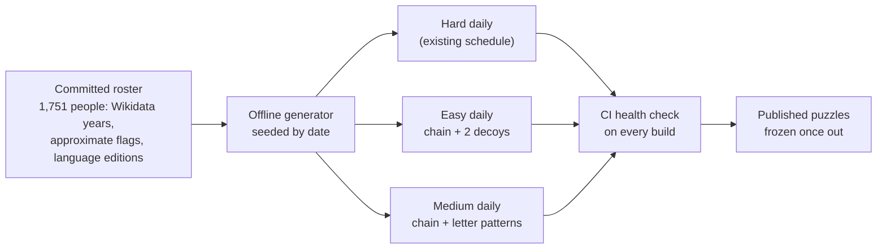
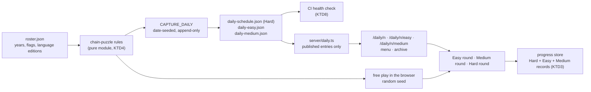

# Three Ways to Play - Plan

## Goal Capsule

- **Objective:** Players who cannot recall and type names fluently can play History Links every day, and streamers keep a competitive mode. Each player picks Easy, Medium or Hard, and each style has its own daily puzzle.
- **Means:** One pure chain-puzzle module builds Easy and Medium puzzles for both the dailies and free play (KTD4), each style's daily kept in its own append-only schedule file (KTD1).
- **Product authority:** This plan, under `STRATEGY.md` (Users; Tracks: free text for streamers, picking for viewers). For Easy and Medium it replaces the meaning of difficulty in `docs/research/2026-11-06-difficulty-balancing.md`; Hard keeps those rules. The share card (#59) and versus (#61) are not active scope.
- **Open blockers:** None.
- **Execution profile:** One PR from `ccr-eb562100-0cl3wr`, which already carries the unmerged daily puzzle and Deck redesign; no project rule asks for a split. Units land as separate commits in dependency order.
- **Stop conditions:** Stop and report if generating the Easy or Medium year fails any day or the health check reports any problem; if any existing entry of `src/lib/data/daily-schedule.json` changes (the capture may append days to keep a year ahead); or if a browser's existing daily record stops showing as its Hard result.
- **Who finishes:** `ce-work` in this session builds, verifies and pushes; a PR opens only when the user asks.
- **Product Contract preservation:** Product Contract unchanged. KTD8 records how R21's checks run against frozen puzzles.

---

## Product Contract

### Summary

Easy, Medium and Hard become three ways to play instead of three pair hardnesses. Easy deals name cards, decoys included, to arrange between the two targets. Medium shows letter-count blanks to fill with the exact people on a fixed chain. Hard is today's typed game, scored against par. Each style gets its own daily puzzle, generated offline, frozen once published and checked in CI.

### Problem Frame

Today every round is free typing: the player must recall a name, spell it and know roughly when that person lived. That suits a streamer showing off, but it shuts out most of the people `STRATEGY.md` counts on: viewers watching on phones, chat, and anyone who recognises famous names without being able to produce them on demand. The current Easy, Medium and Hard only change how far apart the two targets are; the act of playing stays the same, so a player who struggles with recall has no easier way in.

### Key Decisions

- **The three styles are the difficulty scale.** One scale players already understand, rather than a pair hardness plus a separate style setting. Governs R1, R2. (session-settled: user-directed — chosen over keeping pair hardness as the difficulty with styles beside it: three styles are the new Easy, Medium and Hard)
- **Par exists only in Hard.** Easy and Medium have one fixed answer, so counting misses measures them better than strokes against par. Governs R9, R12. (session-settled: user-directed — chosen over scoring every style against par: par matters only for the competitive mode)
- **Three daily puzzles a day, one per style.** Separate puzzles mean finishing one style never spoils another. Governs R13, R15, R16. (session-settled: user-directed — chosen over one shared puzzle locked to the style you start in, the Wordle model: no spoilers, and every style keeps a scored attempt)
- **Medium's answers are the exact people on a fixed chain, shown as letter counts.** A pre-defined chain keeps every answer overlapping and makes the blanks a fair, guessable puzzle. Governs R6, R7, R8. (session-settled: user-directed — chosen over accepting anyone who fits a blank: the chain is pre-defined so all its people overlap)
- **Easy hands include decoys.** Decoys turn a sort into a puzzle. Governs R3, R4. (session-settled: user-directed — chosen over a hand of only the chain's people)
- **Easy and Medium score by misses.** Easy counts Checks, Medium counts wrong guesses and reveals. Governs R9. (session-settled: user-approved — chosen over stars or a plain solved/not result)
- **Fame by style.** Easy draws only on the best-known people; Medium may use the whole roster, so it plays harder. Governs R18. (session-settled: user-directed — chosen over famous-only chains for both styles and over reusing Hard's par chain)
- **The existing daily schedule becomes the Hard daily.** Puzzles #1 and #2 are already published and cannot change. Governs R14.

### Requirements

**Choosing a style**

- R1. The menu offers Easy, Medium and Hard for the daily puzzle and for free play, and each starts a puzzle in that style.
- R2. Every round and every result line names its style, for example "Daily #3 · Medium · 2 misses".

**Easy: arrange the cards**

- R3. The player gets the chain's middle people plus 2 decoys as shuffled name cards with years hidden, and one empty slot per middle person between the two gold targets.
- R4. Exactly one arrangement of the hand into the slots forms a valid chain, and decoys are well-known people born within the puzzle's span.
- R5. Check locks every card in its correct slot and turns it over to show its years; other cards return to the hand, and the round ends when every slot is correct.

**Medium: fill the blanks**

- R6. Only the two targets are shown; each middle person is a blank showing the letter count of each word of their name, without any bracketed disambiguation, and blanks can be filled in any order.
- R7. A guess is matched by person, not spelling, so a name that resolves to the blank's person fills it and the card turns over to show its years.
- R8. A guess that resolves to anyone else is a miss; when that person would also fit between the blank's neighbours, the message says they fit but the chain wants someone else.
- R9. Easy's score is the number of Checks (1 is perfect); Medium's is wrong guesses plus revealed people; both results show the count and one square per slot.
- R10. In Medium the wild card reveals one blank's person and counts as a miss; Easy has no wild card.

**Hard**

- R11. Hard is today's typed game unchanged: any valid chain counts, scored in strokes against par, with the current Hard wild card (+1 stroke).
- R12. Par is shown only in Hard.

**Daily puzzles**

- R13. Each UTC date has an Easy, a Medium and a Hard puzzle, all carrying that date's number (#n).
- R14. The Hard daily is the existing schedule, including its weekday ramp of pair hardness, and published Hard puzzles never change.
- R15. Easy and Medium dailies exist for every date from #1 (2026-11-07) onwards and never change once published.
- R16. Each browser gets one scored attempt per style per puzzle; later replays are practice, and the menu and archive show a status for each style.

**Making the puzzles**

- R17. Every puzzle, daily or free play, is generated from the committed roster, and a daily is seeded by its date and stored as a frozen copy of its people, years, chain and decoys.
- R18. Easy chains use only the 400 best-known people by Wikipedia language editions, Medium chains may use the whole roster, and both take the most famous of the shortest valid chains, with 2 to 4 people between the targets.
- R19. Neighbours in an Easy or Medium chain overlap, and where an approximate year sets either end of their shared stretch they must share at least 5 years.
- R20. A Medium puzzle is rejected when any other roster person who fits a blank has the same letter pattern as that blank's answer.
- R21. CI rechecks every Easy and Medium copy as it already checks Hard: R18, R19 and R20 hold, R4's single arrangement holds, no pair or recent target repeats, and at least 30 days are scheduled ahead.
- R22. Easy and Medium keep the hidden-dates rule: a person's years appear only once that person is correctly placed.

### Key Flows

- F1. An Easy round
  - **Trigger:** The player picks Easy for today's daily or for free play.
  - **Steps:** The two gold targets and the empty slots appear with the hand below. The player places cards and presses Check. Correct cards lock and show their years, the rest return, and the player repeats until every slot is right.
  - **Outcome:** The result shows the number of Checks and one square per slot.
  - **Covered by:** R3, R4, R5, R9, R22
- F2. A Medium round
  - **Trigger:** The player picks Medium.
  - **Steps:** The targets and the letter-count blanks appear. The player selects a blank and types a name. A match fills the blank and shows the years; anything else is a miss with a short message. The wild card can reveal a blank at the cost of a miss.
  - **Outcome:** The result shows the misses and one square per slot.
  - **Covered by:** R6, R7, R8, R9, R10, R22
- F3. Choosing today's style
  - **Trigger:** The player opens the menu.
  - **Steps:** Today's three dailies show with their status. Starting one opens that style's puzzle as a scored attempt; one already finished opens its result; replaying it is practice.
  - **Covered by:** R1, R13, R16

### Acceptance Examples

- AE1. **Covers R5, R9.** Given an Easy hand with three slots, when the player puts two chain people in their right slots and a decoy in the third and presses Check, then two cards lock and show their years, the decoy returns to the hand, and one Check is counted. A correct second Check ends the round at 2 Checks.
- AE2. **Covers R7.** Given a Medium blank whose answer is Isaac Newton, when the player types "Newton", then the blank fills with Isaac Newton and his years appear.
- AE3. **Covers R8.** Given a Medium blank whose neighbours both overlap someone who is not the answer, when the player types that person, then it counts as a miss and the message says they fit but the chain wants someone else.
- AE4. **Covers R16.** Given a player who finished Daily #3 Easy, when they open Daily #3 Medium, then it starts a scored attempt of its own; when they reopen Daily #3 Easy, then they see their result, and playing it again is practice.
- AE5. **Covers R14, R15.** Given Hard #1 published on 2026-11-07, when the three-style schedule ships, then Hard #1 is unchanged and Easy #1 and Medium #1 exist for the same date.
- AE6. **Covers R19.** Given Geoffrey Chaucer (c. 1343 – c. 1400) and someone born in 1398, when the generator considers them as neighbours, then the link is rejected, because the approximate year sets the end of their shared stretch and they share fewer than 5 years.
- AE7. **Covers R20.** Given a Medium blank whose answer has two words of 5 and 6 letters, when another roster person who also fits that blank has the same 5-6 pattern, then the puzzle is rejected and the generator tries another.

### Success Criteria

- The generator produces Easy and Medium puzzles for every date a year ahead without manual fixes.
- A full Easy round can be played without a keyboard.
- Hard results stay comparable with results from before this change.

### Scope Boundaries

- **Deferred for later:**
  - The share card (#59) and versus (#61).
  - Per-letter colour feedback on Medium guesses (Medium shows letter counts only).
  - An Easy wild card.
  - Chat-voting layouts.
  - #60 (pick one of four suggestions each turn) is to be closed or rescoped, since Easy already covers keyboard-free play.
- **Outside this work:** changing Hard's rules or par, and accepting any person who fits a Medium blank.

### Dependencies / Assumptions

- **Feasibility (simulated on 2026-11-08 against `src/lib/data/roster.json`):**
  - About 26% of random non-contemporary pairs from the 400 best-known people have a chain of 2 to 4 middle people under R19, so a date-seeded generator needs about four tries per puzzle.
  - Every one of those chains found 2 decoys that left exactly one valid arrangement (R4).
  - Middle sizes were spread across 2, 3 and 4 people.
  - Medium blanks have a median of 6 other roster people who would also fit (90th percentile 56).
  - The letter pattern singles out the answer in 86% of blanks; R20 rejects the other 14%.
  - 216 of 1,751 roster people (47 of the best-known 400) have an approximate year, which is why R19 has a margin.
- **Assumptions I made (not asked):** 2 decoys per Easy hand; 2 to 4 middle people; a 5-year margin; Hard keeps today's +1-stroke wild card.
- **Existing behaviour this builds on:**
  - Roster years come from Wikidata through the same parser as in-game lookups, so a person's years in a puzzle match what typing their name returns.
  - Fame is the count of Wikipedia language editions recorded when the roster is built, and it does not drift day to day.

### Outstanding Questions

- **Deferred to Planning:**
  - How existing daily records, one per puzzle number today, become Hard records.
  - Whether free-play Easy and Medium puzzles are generated in the browser or drawn from a pre-generated pool.
  - How Medium resolves a guess to a person: a roster match, a live lookup, or both.
  - How the archive lays out three puzzles per date.

### Sources / Research

- `STRATEGY.md`: Users; Tracks (free text for streamers, picking from suggestions for viewers and chat).
- `src/lib/data/roster.ts:7-40`: roster row with years, approximate-date flags and language-edition count.
- `src/lib/utils/difficulty.ts:32`: the 400 best-known people (`FAMOUS_COUNT`).
- `src/lib/services/dailyScheduleBuild.ts:15-29`: date-seeded generation.
- `src/lib/data/dailySchedule.ts:119`: the schedule health check that R21 extends.
- `docs/plans/2026-11-07-1521-feat-daily-shared-puzzle-plan.md`: the daily puzzle this extends.
- Issues #60 (suggestion picks) and #81 (one-answer puzzles).
- External models:
  - Wordle locks hard mode once the first guess is made ([GameRevolution](https://www.gamerevolution.com/guides/699992-wordle-hard-mode-how-to-turn-on-differences-harder-expert)).
  - NYT Sudoku publishes separate Easy, Medium and Hard puzzles daily ([guide](https://sudokupulse.pages.dev/articles/nyt-sudoku-tips)).
  - Quordle runs separate daily sets per mode ([Sportskeeda](https://www.sportskeeda.com/mobile-games/different-modes-quordle)).

---

## Planning Contract

### Key Technical Decisions

- KTD1. **Easy and Medium dailies live in their own schedule files.** `src/lib/data/daily-easy.json` and `src/lib/data/daily-medium.json` share the Hard schedule's first date and numbering, are append-only, and are read only on the server. Adding fields to the Hard file would rewrite published lines. Governs R13, R15. (session-settled: user-approved — chosen over new fields on each Hard entry: published Hard lines never change)
- KTD2. **`/daily/<n>` stays the Hard puzzle; Easy and Medium live at `/daily/<n>/easy` and `/daily/<n>/medium`.** Links already shared keep working. Governs R1, R13, R14. (session-settled: user-approved — chosen over a style query parameter on one route: existing links stay Hard)
- KTD3. **Hard records stay where they are; style records sit beside them.** The progress store keeps its key and its per-number Hard attempts, and gains Easy and Medium attempts keyed the same way, so a browser's existing record reads as its Hard result with no migration step. Governs R16. (session-settled: user-approved — chosen over a new storage key with a migration: nothing to migrate, nothing lost)
- KTD4. **One pure chain-puzzle module serves the daily capture and free play.** It owns the overlap-with-margin rule, the fame-maximising shortest chain, decoy selection with the single-arrangement proof, and letter patterns. The capture seeds it by date; free play seeds it at random in the browser, where a full year of Easy took 0.4 s and of Medium 10 s in the feasibility run. Governs R4, R17, R18, R19, R20. (session-settled: user-approved — chosen over a pre-generated free-play pool: same rules everywhere, nothing extra to ship)
- KTD5. **Medium judges a guess on the device first, then online.** A guess equal to the answer's name, or to its surname, fills the blank at once. Any other name is checked against the roster, then by a live lookup comparing Wikidata IDs, which catches other names for the same person. If Wikipedia cannot be reached, the guess is not counted. Governs R7, R8. (session-settled: user-approved — chosen over live lookup only: "Newton" is a disambiguation page on Wikipedia and would fail)
- KTD6. **Portraits come from one batched Wikipedia request per puzzle, through `wikimediaClient`.** Initials stand in when a portrait is missing or the request fails. The new request URL needs one fixture re-record. (session-settled: user-approved — chosen over one person lookup per card: four requests a card would hit Wikimedia's rate limit)
- KTD7. **Easy and Medium answers are delivered to the browser.** Checks run without a server, as the Hard par chain does today. A player could read answers from the page source; accepted for a casual game with no backend. (session-settled: user-approved — chosen over a server check per guess: no backend exists)
- KTD8. **CI checks frozen puzzles on what they store.** Every entry is checked for links with the margin, a single Easy arrangement, letter patterns from the stored names, and the fame recorded at generation. The roster-wide checks (R18's fame pool, R20's unique pattern) run against the roster revision the entry was generated from, and are skipped for entries generated from an older revision, so a roster rebuild never fails a published puzzle. Governs R21. (session-settled: user-approved — chosen over rechecking every entry against the current roster: published puzzles are frozen)
- KTD9. **Free-play Hard picks its pair hardness at random in the daily's weekly proportions (easy 2, medium 2, hard 3 in 7).** (session-settled: user-approved — chosen over always the hardest band: Hard is a way to play, not only the hardest pairs)
- KTD10. **Hard always uses Hard rules for hints and strokes; the pair band only chooses the pair and labels analytics.** Today a Monday daily used Easy hint rules. Governs R11. (session-settled: user-approved — chosen over weekday hint rules: Hard is the competitive game every day)
- KTD11. **Easy places cards by tap: tap a card, then a slot.** Works on touch, mouse and keyboard without drag, and keeps the Easy round keyboard-free. Governs R3, R5.

### High-Level Technical Design

Slot states in an Easy or Medium round:

| State | Easy | Medium | Shows |
|---|---|---|---|
| Empty | No card placed | Not yet guessed | Card outline (Easy) or letter boxes (Medium) |
| Placed | Card placed, not checked | n/a | The card's name, years hidden |
| Locked | Right card after a Check | Answer guessed | Portrait, name and years |
| Revealed | n/a | Shown by the wild card | Portrait, name and years, marked as revealed |

### Assumptions

- Free-play Easy and Medium rounds are not resumed after a reload; only Hard free play keeps its save today.
- Medium's surname shortcut uses the last word of the answer's name that is at least three letters long, and applies only to names with no bracket, no "of …" or "the …" part and no regnal numeral. Otherwise "England" would fill Henry VIII of England and "Great" would fill any of the 20 roster people called "the Great". Those names fill by their full name, a roster match or the live lookup.

### Deferred to Follow-Up Work

- Share text built from the per-slot squares (#59).
- Rescoping or closing #60 once Easy ships.

---

## Implementation Units

| U-ID | Title | Key files | Depends on |
|---|---|---|---|
| U1 | Chain-puzzle rules | `src/lib/utils/chainPuzzle.ts` | none |
| U2 | Easy and Medium schedules | `src/lib/data/styleSchedule.ts`, `src/lib/services/styleScheduleBuild.ts`, `daily-easy.json`, `daily-medium.json` | U1 |
| U3 | Progress per style | `src/lib/utils/dailyProgress.ts` | none |
| U4 | Guess matching and portraits | `src/lib/utils/guessMatch.ts`, `src/lib/services/WikipediaService.ts` | none |
| U5 | Easy round | `src/lib/utils/styleRound.ts`, `src/lib/components/EasyRound.tsx`, `src/lib/components/ui/StyleResult.tsx` | U1, U4 |
| U6 | Medium round | `src/lib/utils/styleRound.ts`, `src/lib/components/MediumRound.tsx` | U1, U4, U5 |
| U7 | Daily routes per style | `src/app/daily/[n]/easy/page.tsx`, `src/app/daily/[n]/medium/page.tsx`, `src/lib/components/DailyStyleRound.tsx` | U2, U3, U5, U6 |
| U8 | Free play by style | `src/app/play/page.tsx`, `src/lib/components/ui/DifficultyChoice.tsx` | U1, U5, U6 |
| U9 | Menu and archive per style | `src/lib/components/ui/DailyHome.tsx`, `src/lib/components/ui/ArchiveList.tsx` | U2, U3, U7 |
| U10 | Analytics and documentation | `src/lib/utils/roundEvents.ts`, `DEPLOYMENT.md`, `CLAUDE.md`, `DESIGN.md` | U5 to U9 |

### U1. Chain-puzzle rules

**Goal:** Pure functions that build and prove Easy and Medium puzzles from the roster.

**Requirements:** R4, R18, R19, R20; KTD4.

**Dependencies:** None.

**Files:**
- Create `src/lib/utils/chainPuzzle.ts`
- Test `src/lib/utils/chainPuzzle.test.ts` (catches rule regressions on small hand-built rosters; misses roster-wide yield, which U2's capture run covers)

**Approach:**
1. A link test that applies R19's margin when an approximate year sets either end of the shared years.
2. The fame-maximising shortest chain between two people inside a pool, limited to 2 to 4 people between them (R18).
3. An arrangement counter that stops at two, and a decoy picker drawing well-known people born inside the puzzle's span until the hand has exactly one valid arrangement (R4).
4. Letter patterns per word, without bracketed disambiguation, and the R20 test against roster people who fit a blank.
5. Builders for an Easy puzzle (targets, chain, 2 decoys) and a Medium puzzle (targets, chain), each taking a random source so the capture can seed by date and free play at random, and a set of people to leave out. Both styles draw their two targets from the 400 best-known people, as the feasibility run did; only Medium's middle people may come from the whole roster.

**Patterns to follow:** `src/lib/utils/difficulty.ts` (`famousPeople`, `pickTargets`); `src/lib/utils/ChainAnalyzer.ts` (`areContemporaries`); the feasibility script's chain search and arrangement count.

**Test scenarios:**
- Happy path: two exact-dated people sharing 2 years link.
- Happy path: the chain builder prefers the chain whose least famous member is more famous when two shortest chains exist.
- Edge case: Chaucer (c. 1343 – c. 1400) and someone born 1398 do not link (AE6).
- Edge case: a pair needing 5 middle people, or only 1, returns no chain.
- Edge case: a hand where two middle people can swap places counts 2 arrangements and is rejected.
- Edge case: "Charles I (king)" yields the pattern 7-1 with the bracket removed.
- Error path: a blank whose answer shares a pattern with another fitting roster person fails the R20 test (AE7).
- Integration: the same date seed builds the same Easy and Medium puzzle twice.

**Verification:** All rules hold on hand-built cases, and the builders are deterministic for a given seed.

### U2. Easy and Medium schedules

**Goal:** A year of Easy and Medium dailies from #1, frozen, served only by the server and checked in CI.

**Requirements:** R13, R15, R17, R21; KTD1, KTD8.

**Dependencies:** U1.

**Files:**
- Create `src/lib/data/styleSchedule.ts` (types, parsing, published access, health check; never imports the JSON)
- Create `src/lib/services/styleScheduleBuild.ts` (append-only generator)
- Create `src/lib/data/daily-easy.json` and `src/lib/data/daily-medium.json`
- Modify `src/lib/services/daily.capture.test.ts` (extends all three schedules)
- Modify `src/lib/server/daily.ts` (readers for each style's published puzzles)
- Test `src/lib/data/styleSchedule.test.ts` and `src/lib/services/styleScheduleBuild.test.ts` (catch broken snapshots and non-appending generation; miss rendering)

**Approach:**
1. Entries hold the date, number, targets, chain and (Easy) decoys as stored person rows, plus each member's language-edition count and the roster revision. The revision must change whenever the roster's rows change, for example a hash of the rows. The Hard file's `rosterRevision` is the Wikipedia list's revision, which stays the same when the roster is rebuilt from the same list.
2. The generator appends days after the last entry, seeding each by style and date, never rewriting existing entries, and keeping the Hard schedule's pair and recent-target rules within each style.
3. No person appears in two styles' puzzles on the same date, so finishing one style never gives away another. Easy leaves out that date's Hard targets and par chain. Medium also leaves out that date's Easy targets, chain and decoys. Without this, 96 of 366 simulated dates had a Medium answer that also appeared in that day's Easy or Hard puzzle. With it, the simulated year still filled every date, at 8.5 tries a day for Easy and 12.5 for Medium.
4. The health check applies KTD8 and the same-date rule, and fails when fewer than 30 entries remain after today, as `scheduleProblems` does for Hard.
5. The capture extends Hard as before, then gives Easy and Medium one entry for every Hard entry, through the Hard schedule's last date.

**Patterns to follow:** `src/lib/data/dailySchedule.ts` (`scheduleProblems`, `publishedPuzzle`); `src/lib/services/dailyScheduleBuild.ts`; `src/lib/server/daily.ts`.

**Test scenarios:**
- Happy path: the committed Easy and Medium files pass the health check today.
- Happy path: generating from an existing file only appends, and earlier entries are byte-identical.
- Error path: an entry with a link short of the margin, a second valid arrangement or a duplicate pair is reported.
- Error path: an Easy or Medium entry sharing a person with another style's puzzle on the same date is reported.
- Edge case: an entry generated from an older roster revision skips the roster-wide checks but still passes the snapshot checks.
- Edge case: puzzle n after today is not returned by the server reader.

**Verification:** The capture writes one Easy and one Medium entry for every Hard entry from 2026-11-07 with no problems, and every existing entry of `daily-schedule.json` is unchanged.

### U3. Progress per style

**Goal:** Each browser keeps one scored attempt per style per puzzle, with existing records read as Hard.

**Requirements:** R16; KTD3.

**Dependencies:** None.

**Files:**
- Modify `src/lib/utils/dailyProgress.ts`
- Modify `src/lib/hooks/useDailyProgress.ts` only if the store's shape requires it
- Test `src/lib/utils/dailyProgress.test.ts`

**Approach:**
1. Add Easy and Medium attempts beside the Hard attempts. Each holds the board in progress (placements or guesses), misses or checks so far, and a result once finished.
2. Opening, saving, finishing and status follow the Hard rules: a finished attempt shows its result, an unfinished one resumes, today's starts scored, a past one is practice.
3. Normalisation keeps every existing record valid and adds empty style records.

**Patterns to follow:** `openPuzzle`, `saveRound`, `finishScored`, `puzzleStatus` and `normalizeDailyProgress` in `src/lib/utils/dailyProgress.ts`.

**Test scenarios:**
- Happy path: finishing Easy #3 leaves Medium #3 unplayed and scored (AE4).
- Happy path: a stored record from before this change opens as Hard #1's result.
- Edge case: practice on Easy #2 never touches the scored Easy #2 attempt.
- Edge case: malformed style records are dropped without losing the Hard ones.

**Verification:** Existing records read as Hard results, and each style keeps its own attempt and status.

### U4. Guess matching and portraits

**Goal:** Decide whether a Medium guess names the blank's person, and fetch portraits for a puzzle in one request.

**Requirements:** R7, R8; KTD5, KTD6.

**Dependencies:** None.

**Files:**
- Create `src/lib/utils/guessMatch.ts`
- Test `src/lib/utils/guessMatch.test.ts` (catches name-normalisation mistakes; misses live Wikipedia behaviour)
- Modify `src/lib/services/WikipediaService.ts` (batched portraits)
- Modify `src/lib/services/wikimedia.capture.test.ts` and `src/lib/services/__fixtures__/wikimedia-responses.json` (the new request)
- Test `src/lib/services/WikipediaService.test.ts`

**Approach:**
1. Normalise case, accents and punctuation, then compare against the answer's full name without any bracket, and its surname as the Assumptions define it (KTD5).
2. Otherwise resolve the guess against the roster by name and report whether that person fits between the blank's neighbours.
3. Otherwise the round falls back to `lookupPerson` and compares Wikidata IDs. A network failure returns "not checked".
4. Portraits: one Wikipedia query for all titles of a puzzle, returning a title-to-thumbnail map; missing titles get none.

**Patterns to follow:** `lookupPerson` and `searchPerson` in `src/lib/services/WikipediaService.ts`; requests only through `src/lib/services/wikimediaClient.ts`.

**Test scenarios:**
- Happy path: "Newton", "isaac newton" and "Isaac Newton" match Isaac Newton (AE2).
- Happy path: "Leonardo da Vinci" matches its own answer, but "da" does not.
- Edge case: "Goethe" matches "Johann Wolfgang von Goethe".
- Edge case: "England" does not match "Henry VIII of England", and "Great" does not match "Alexander the Great".
- Error path: a roster person who fits but is not the answer is a miss marked as fitting (AE3).
- Error path: a network failure during the fallback lookup is not a miss.
- Integration: the batched portrait request returns thumbnails for three titles from the recorded fixture.

**Verification:** Guesses resolve per KTD5, and portraits arrive from a single request.

### U5. Easy round

**Goal:** The Easy round on the card table: slots between the gold targets, a hand with decoys, tap to place, Check, and the result.

**Requirements:** R2, R3, R5, R9, R10, R12, R22; F1; AE1; KTD11.

**Dependencies:** U1, U4.

**Files:**
- Create `src/lib/utils/styleRound.ts` (pure round state for Easy and Medium: placing, returning, checking, guessing, revealing, per-slot outcomes and the score)
- Test `src/lib/utils/styleRound.test.ts` (catches rule and scoring mistakes; misses layout and touch, which the browser checks cover)
- Create `src/lib/components/EasyRound.tsx`
- Create `src/lib/components/ui/StyleResult.tsx` (result for Easy and Medium: count, per-slot squares, the chain, one action)
- Modify `src/lib/components/ui/WinModal.tsx` (export its hand of small cards for reuse)

**Approach:**
1. Phone: the targets top and bottom, the slots between them, the hand below; desktop: the same table with the hand in the left column, as on the Hard screen. The header names the style and shows Checks, never par.
2. Tap a hand card to select it, then a slot to place it; tap a placed card to send it back.
3. Check locks right cards (the card turns over and shows its years), returns the rest, and counts one Check. No wild card (R10).
4. The result appears when every slot is locked.
5. Cards use the Deck card face (`src/lib/components/ui/Portrait.tsx`, card stock, era spine); portraits come from U4.

**Patterns to follow:** `src/lib/components/Board.tsx` (card face, landing turn); `src/lib/components/GameRound.tsx` (header, dock, safe areas); `DESIGN.md`.

**Test scenarios:**
- Happy path: two right cards and a decoy, then Check, locks two slots, returns the decoy and counts 1 Check (AE1).
- Happy path: a second, correct Check finishes the round at 2 Checks, with squares marking each slot's Check.
- Edge case: Check is unavailable until every slot holds a card.
- Edge case: a locked card cannot be moved or returned.
- Edge case: placing a card on an occupied, unlocked slot sends the earlier card back to the hand.
- Integration (browser): on a 390 px phone, an Easy round plays to its result by tapping only, and a locked card shows its years.

**Verification:** An Easy round plays to its result on a 390 px phone and at 1440 px with no keyboard.

### U6. Medium round

**Goal:** The Medium round: targets, letter-count blanks, guessing, the wild card reveal, and the result.

**Requirements:** R2, R6, R7, R8, R9, R10, R12, R22; F2; AE2, AE3.

**Dependencies:** U1, U4, U5 (`StyleResult`).

**Files:**
- Modify `src/lib/utils/styleRound.ts` and `src/lib/utils/styleRound.test.ts` (Medium state)
- Create `src/lib/components/MediumRound.tsx`

**Approach:**
1. The first empty blank is selected, and tapping another blank selects it.
2. The name field with suggestions sits in the dock, as in Hard.
3. A guess resolves per KTD5: a match locks the blank; a miss adds one and shows one line, with the "fits, but the chain wants someone else" wording when U4 says so. A guess that resolves to no person is not a miss (R8 counts only guesses that resolve to someone else); it shows the lookup's reason, as Hard does.
4. The wild card reveals the selected blank and counts a miss.

**Patterns to follow:** `src/lib/components/GameRound.tsx` (dock, `SearchBar`, the one-line reveal in `ui/PlacementReveal.tsx`).

**Test scenarios:**
- Happy path: a matching guess locks the selected blank and moves the selection to the next empty blank.
- Happy path: a wrong guess adds one miss and leaves the blank empty.
- Edge case: a guess the network could not check changes nothing.
- Edge case: a guess that names no person (a typo, a disambiguation page) shows its reason and adds no miss.
- Edge case: the wild card on the last empty blank finishes the round, counting the reveal as a miss.
- Edge case: guessing the answer of a different blank than the one selected is a miss for the selected blank.
- Integration (browser): typing "Newton" for an Isaac Newton blank fills it (AE2), and a fitting non-answer shows the "fits, but" line (AE3).

**Verification:** A Medium round plays to its result, counting misses and reveals.

### U7. Daily routes per style

**Goal:** Each date's Easy and Medium dailies open from their own URLs as scored attempts, results or practice.

**Requirements:** R1, R13, R14, R15, R16; F3; AE4, AE5; KTD2, KTD10.

**Dependencies:** U2, U3, U5, U6.

**Files:**
- Create `src/app/daily/[n]/easy/page.tsx` and `src/app/daily/[n]/medium/page.tsx`
- Create `src/lib/components/DailyStyleRound.tsx` (opening, saving and finishing for Easy and Medium, like `DailyRound`)
- Modify `src/lib/components/DailyRound.tsx` (Hard rules every day per KTD10; the band goes to analytics only)
- Modify `src/app/daily/[n]/page.tsx` only for links to the other styles
- Test: `src/lib/utils/dailyProgress.test.ts` covers the opening rules; browser checks cover the routes

**Approach:**
1. The server pages pass only published entries, as `/daily/<n>` does today. Future and unknown numbers show the existing "not out yet" card.
2. `DailyStyleRound` saves every change through U3 and records the result on completion.
3. The Hard page stays at its URL and passes Hard to `GameRound` regardless of the weekday band.

**Patterns to follow:** `src/app/daily/[n]/page.tsx`; `src/lib/components/DailyRound.tsx`.

**Test scenarios:**
- Integration: `/daily/1` still shows Ibn Battuta to Walter Scott as Hard (AE5).
- Integration: `/daily/1/easy` and `/daily/1/medium` show their own pairs.
- Integration: `/daily/<tomorrow>/easy` shows "not out yet" with no puzzle data in the HTML.

**Verification:** All three styles open for every published number, and future ones reveal nothing.

### U8. Free play by style

**Goal:** Free play starts Easy and Medium puzzles generated in the browser, and Hard with a varied pair.

**Requirements:** R1, R11, R12, R17; KTD4, KTD9, KTD10.

**Dependencies:** U1, U5, U6.

**Files:**
- Modify `src/app/play/page.tsx` (`?d=easy|medium|hard` starts that style)
- Modify `src/lib/components/ui/DifficultyChoice.tsx` (each card says how it plays; par appears only on Hard)
- Modify `src/lib/services/TargetSelectionService.ts` only if the Hard band draw needs it
- Modify `src/lib/hooks/useGameState.ts` (the save records the round as Hard and keeps the band for the pair and analytics)
- Test `src/lib/services/TargetSelectionService.test.ts` (the weighted band draw)

**Approach:**
1. Easy and Medium: load the roster, then build a puzzle with U1 from a random seed.
2. Hard: draw the band per KTD9, then pick targets as today. The round runs on Hard rules and its header says Hard (KTD10, R2). Today the play page passes the band to `GameRound` as the difficulty, which sets the header word, the hint rules and the strokes.
3. A free-play save from before this change (difficulty easy, medium or hard) restores as a Hard round.
4. Play again starts another puzzle of the same style.

**Test scenarios:**
- Happy path: the band draw over many seeds lands near 2:2:3.
- Integration: `/play?d=easy` reaches an Easy round with 2 to 4 slots and 2 decoys.
- Integration: a free-play Hard round drawn in the easy band shows Hard in its header and adds a stroke for its wild card.
- Integration: a save written before this change with difficulty "medium" restores as a Hard round, and the menu's link to it says Hard.

**Verification:** All three styles start from the menu's cards.

### U9. Menu and archive per style

**Goal:** The menu shows today's three dailies with their status, and the archive shows each date's three.

**Requirements:** R1, R2, R12, R16; F3.

**Dependencies:** U2, U3, U7.

**Files:**
- Modify `src/lib/components/ui/DailyHome.tsx` and `src/app/page.tsx`
- Modify `src/lib/components/ui/ArchiveList.tsx` and `src/app/archive/page.tsx`
- Modify `src/lib/components/ui/HowToPlay.tsx` (one short step per style)
- Test: browser checks

**Approach:**
1. The daily card lists Easy, Medium and Hard, each with Play, Continue or its result ("2 checks", "1 miss", "5 / par 5"), and the countdown.
2. Archive rows show the date with one status per style, each linking to its puzzle.
3. Free play's Continue link names Hard, never the pair band (U8).
4. How to play gives one short step per style: Easy counts Checks; Medium counts misses, and a reveal costs one; Hard counts strokes against par. Today the sheet describes only the typed game and par, and `DESIGN.md` keeps rules off the playing surfaces.

**Patterns to follow:** the current `DailyHome` and `ArchiveList`; `DESIGN.md`'s "Saying less".

**Test scenarios:**
- Integration: after finishing Easy #1, the menu shows Easy's result while Medium and Hard still say Play.

**Verification:** Menu and archive reflect each style's status on a phone and at 1440 px.

### U10. Analytics and documentation

**Goal:** Round events name their style, and the docs describe three ways to play.

**Requirements:** R2.

**Dependencies:** U5 to U9.

**Files:**
- Modify `src/lib/utils/roundEvents.ts` and `src/lib/utils/roundEvents.test.ts`
- Modify `DEPLOYMENT.md` (events table, schedule runbook for three files)
- Modify `CLAUDE.md` (layout, data flow, the new schedule files and routes)
- Modify `DESIGN.md` (Easy and Medium surfaces)

**Approach:** Every round event carries the style; Hard events keep par and the pair band. Easy and Medium completions carry checks or misses and reveals.

**Test scenarios:**
- Happy path: an Easy completion's properties include the style and the number of checks.
- Happy path: a Hard completion keeps strokes, par and the band.

**Verification:** Event properties match the table in `DEPLOYMENT.md`.

---

## Verification Contract

| Gate | Command or check | Proves |
|---|---|---|
| Unit tests | `npm test` | U1 to U6, U8 and U10 rules, and existing suites |
| Types | `npx tsc --noEmit` | prop and data contracts across pages and rounds |
| Lint | `npm run lint` | no new errors |
| Build | `npm run build` | routes compile; the schedule files stay server-only |
| Schedules | `CAPTURE_DAILY=1 npx vitest run src/lib/services/daily.capture.test.ts --silent=false` | one Easy and one Medium entry for every Hard entry from #1, no problems, no person shared across a date's styles, and every existing entry of `daily-schedule.json` unchanged |
| Bundle | search `.next/static` for fields only the Easy and Medium schedule files carry | future puzzles never reach client code |
| Browser | Playwright on `npx next start`, iPhone 13 and 1440 px | F1, F2, F3, AE1 to AE5, existing Hard flows |

The fixture re-record (`CAPTURE_WIKIMEDIA=1 npx vitest run src/lib/services/wikimedia.capture.test.ts`) runs once for U4's new request; Wikimedia may rate-limit the sandbox, in which case the batched request is recorded by hand from one live response.

---

## Definition of Done

- R1 to R22 are met, and F1 to F3 and AE1 to AE7 are proven by the unit tests and browser checks named above.
- All gates in the Verification Contract pass, and the schedule files cover a year from 2026-11-07.
- Hard #1 and #2 are unchanged, and a browser that played them still sees its results as Hard.
- `CLAUDE.md`, `DEPLOYMENT.md` and `DESIGN.md` describe the three styles.
- No experimental or abandoned code remains in the diff.
- Per unit: each unit's Verification line holds.
